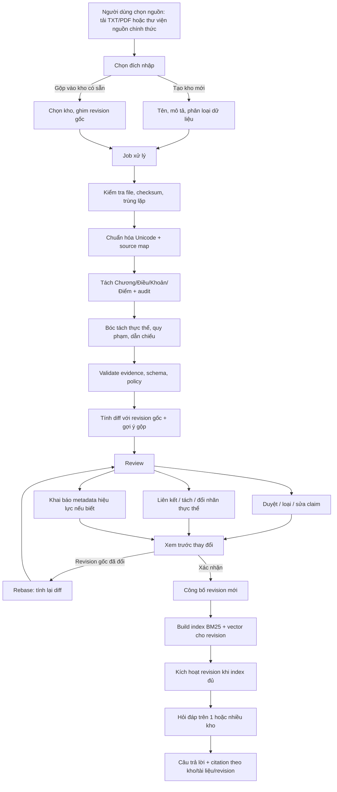
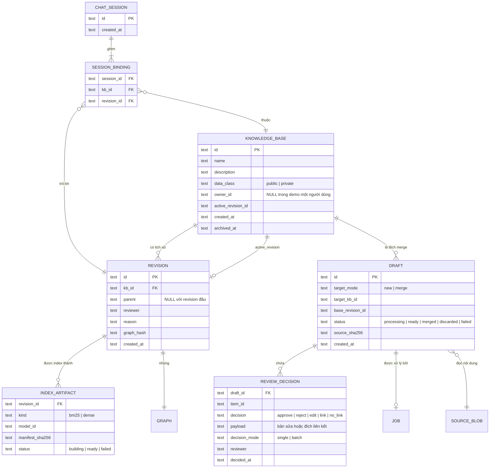
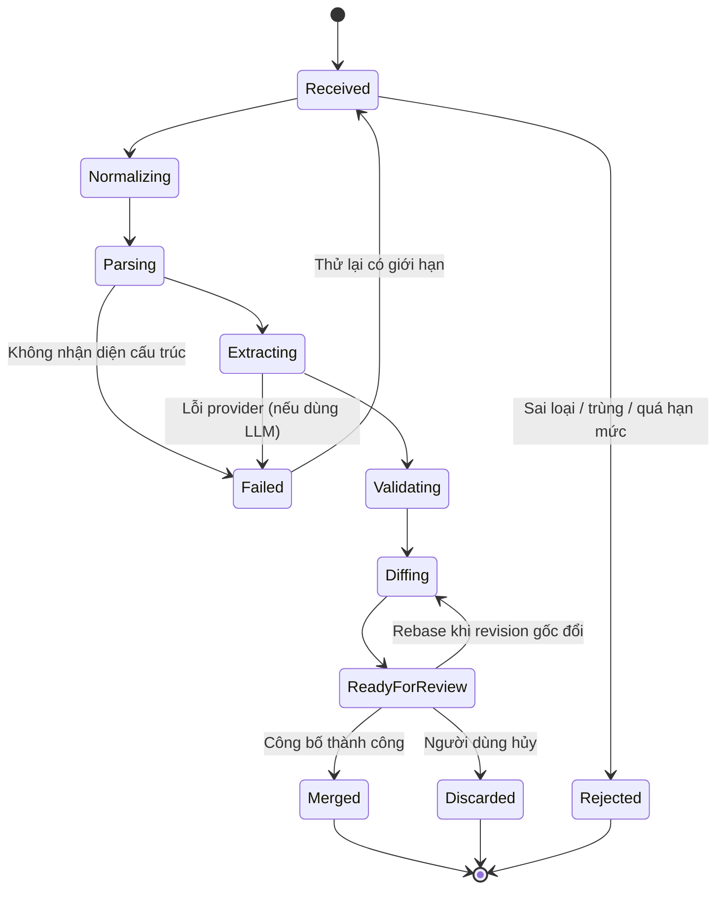
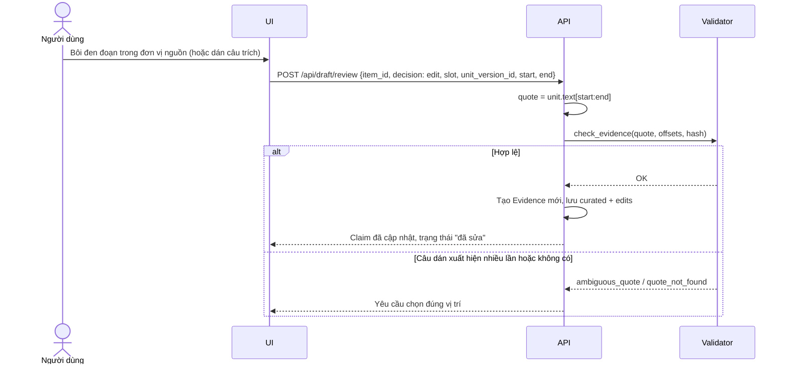
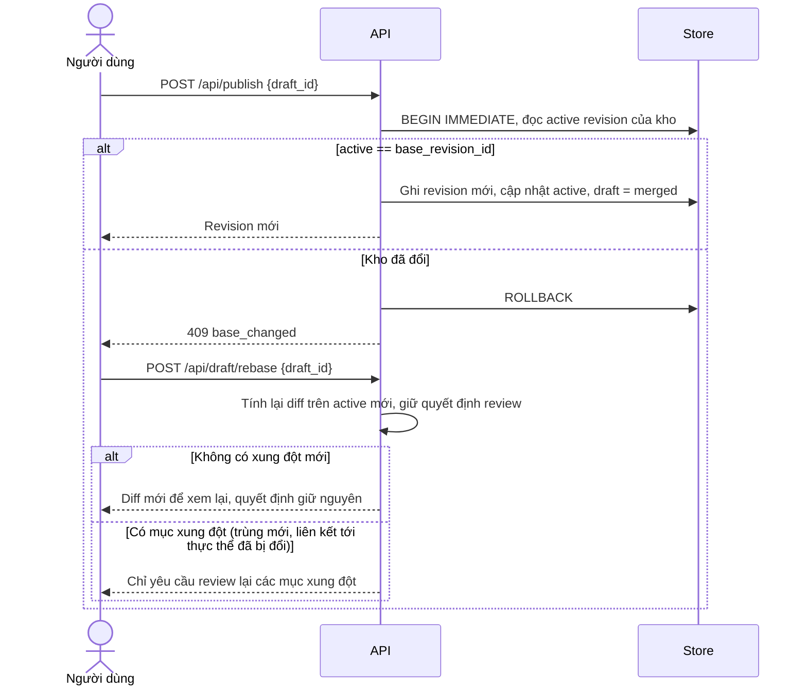
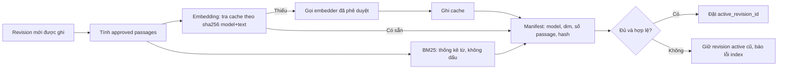
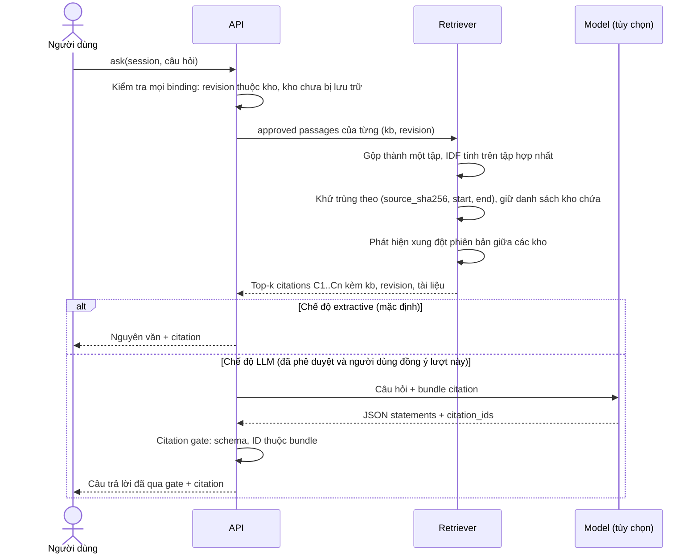
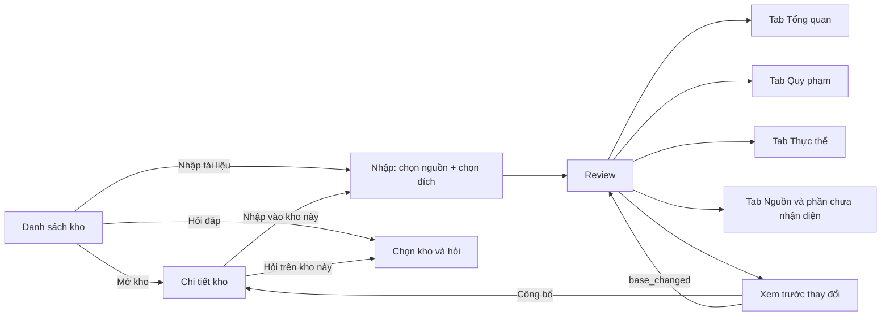
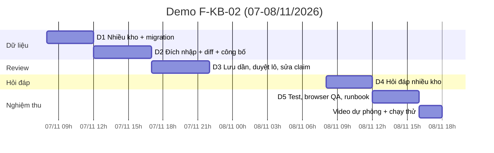

# F-KB-02 - Vòng đời kho tri thức: nhập, review, tạo mới hoặc gộp, hỏi đáp nhiều kho

Ngày 06/11/2026.
Trạng thái: thiết kế chi tiết; phần demo D1-D4 đã triển khai ngày 06/11 (mục 15.1); tách bằng LLM, độ phủ câu và tìm kết hợp embedding đã có bản đầu (mục 15.2); phần MVP còn lại chưa triển khai.
Tài liệu này cụ thể hóa [F-KB-01](private-legal-knowledge-base.md) thành mô hình dữ liệu, luồng xử lý, API, màn hình và kế hoạch thực thi.
Phần đã có trong code được mô tả ở [reviewed-kb-chat.md](reviewed-kb-chat.md); mục 15 liệt kê chênh lệch giữa thiết kế và code.
Mọi kết quả bóc tách vẫn là ứng viên cần review, không phải sự thật pháp lý đã xác minh.

## 1. Mục tiêu

Người dùng có một hoặc nhiều kho tri thức riêng.
Khi tải tài liệu lên, hệ thống tách cấu trúc, bóc tách thực thể và quy phạm có bằng chứng, rồi chuẩn bị dữ liệu cho truy xuất.
Người dùng review kết quả: duyệt, loại, chỉnh sửa, gộp thực thể.
Trước khi ghi, người dùng chọn đích: tạo kho mới hoặc gộp vào một kho đã có, và xem trước toàn bộ thay đổi.
Sau khi công bố, người dùng chọn một hoặc nhiều kho để hỏi đáp; mọi câu trả lời dẫn về đúng câu trích, đúng tài liệu và đúng revision.

## 2. Nguyên tắc bất biến

Các nguyên tắc dưới đây là ràng buộc thiết kế, không phải gợi ý.
Mọi thay đổi trong tương lai phải giữ được chúng.

1. **Văn bản nguồn bất biến.**
   Offset Unicode `[start,end)` và SHA-256 của văn bản chuẩn hóa neo vào nguồn.
   Người dùng không sửa nội dung nguồn; muốn đổi nội dung thì nhập một tài liệu hoặc phiên bản mới.
2. **Chỉ tri thức rút ra mới được chỉnh sửa.**
   Thực thể, quy phạm và các slot có thể sửa, nhưng mọi slot "present" phải trỏ về một câu trích có thật trong nguồn.
3. **Bản máy và bản người sửa tách biệt.**
   Kết quả máy trích không bị ghi đè; bản người sửa là một lớp riêng có người sửa, thời điểm và lý do.
4. **Revision bất biến, công bố nguyên tử.**
   Mỗi lần công bố tạo một revision mới; revision cũ giữ nguyên để session cũ và citation lịch sử vẫn truy được.
5. **Chỉ nội dung đã duyệt mới vào truy xuất.**
   Claim bị loại, chưa quyết định hoặc chỉ là nháp không bao giờ vào index hay context của model.
6. **Phạm vi kho được kiểm tra ở backend.**
   Mọi API nhận `kb_id` hoặc `revision_id` đều kiểm tra revision thuộc kho đó; một ID tồn tại chưa chứng minh nó thuộc đúng kho.
7. **Không tự suy luận pháp lý.**
   Trùng nhãn chỉ là gợi ý gộp; ngày mới hơn không có nghĩa là thay thế; hiệu lực giữ `unknown` khi chưa có nguồn.
8. **Dữ liệu chỉ rời máy khi được phép.**
   Mọi lời gọi model ngoài (bóc tách, embedding, sinh câu trả lời) cần phê duyệt theo `AGENTS.md` và đồng ý theo từng kho.

## 3. Thuật ngữ

| Thuật ngữ | Nghĩa trong Lexora |
|---|---|
| Kho tri thức (KB) | Tập tài liệu và tri thức đã duyệt của một người dùng, có lịch sử revision riêng |
| Tài liệu | Một văn bản nguồn; định danh theo nội dung chuẩn hóa (`document_version_id = normalized_sha256`) |
| Bản nháp nhập (draft) | Kết quả xử lý một tài liệu, kèm đích nhập và các quyết định review đang làm dở |
| Đích nhập | `new` (tạo kho mới) hoặc `merge` (gộp vào kho đã có, trên một revision gốc xác định) |
| Revision | Ảnh chụp bất biến của toàn bộ graph một kho sau một lần công bố |
| Claim (quy phạm) | `NormClaim`: modality và các slot actor/action/object/conditions/exceptions/... có evidence |
| Evidence | Câu trích chính xác, offset và hash của đơn vị nguồn |
| Đề cập thực thể | Node `Entity` hoặc `LegalConcept` gắn với câu trích trong một tài liệu |
| Liên kết thực thể | Cạnh `REVIEWED_ENTITY_LINK` do người duyệt tạo, nối hai đề cập cùng nghĩa trong một kho |
| Session hỏi đáp | Cuộc trò chuyện ghim cố định một tập `(kb_id, revision_id)` |

## 4. Luồng tổng thể



Hai ranh giới quan trọng:

- **Trước review** chỉ làm những gì cần để review: parse, bóc tách, validate, diff.
- **Sau công bố** mới làm những gì cần để trả lời: index BM25, embedding, kích hoạt revision.

Như vậy tài nguyên không bị tốn cho nội dung sẽ bị loại, và không có đường nào để claim bị loại lọt vào index.

## 5. Mô hình dữ liệu

### 5.1 Quan hệ thực thể



### 5.2 Bảng SQLite đề xuất

Giữ SQLite và thư viện chuẩn như hiện tại.
Graph tiếp tục lưu dạng JSON canonical trong revision, kèm `graph_hash` để kiểm tra toàn vẹn.

| Bảng | Cột chính | Ghi chú |
|---|---|---|
| `knowledge_bases` | `id, name, description, data_class, owner_id, active_revision_id, created_at, archived_at` | `name` duy nhất trong phạm vi owner |
| `revisions` | `id, kb_id, parent, created_at, body` | Thêm `kb_id` so với hiện tại; `body` giữ graph, reviewer, reason, review |
| `drafts` | `id, target_mode, target_kb_id, base_revision_id, status, body` | `body` giữ raw/normalized text, parser audit, graph nháp, diff |
| `review_decisions` | `draft_id, item_id, decision, payload, decision_mode, reviewer, decided_at` | Lưu tự động từng quyết định để review có thể dừng và tiếp tục |
| `jobs` | `id, draft_id, stage, status, attempts, error_code, updated_at` | Dùng khi chuyển xử lý sang nền; demo có thể chạy đồng bộ |
| `index_artifacts` | `revision_id, kind, model_id, manifest_sha256, status, body` | Vector lưu dạng BLOB float32 (module `array`) |
| `embedding_cache` | `key, model_id, dim, vector` | `key = sha256(model_id + text)`, dùng lại giữa các kho cùng owner |
| `chat_sessions` | `id, body` | `body.bindings = [{kb_id, revision_id}]` thay cho một `revision` |

### 5.3 Migration từ store hiện tại

Store `import-review-v1` hiện có một chuỗi revision và không có khái niệm kho.
Migration tạo phiên bản `kb-store-v1`:

1. Tạo bảng `knowledge_bases` và một kho "Kho mặc định".
2. Gán toàn bộ revision hiện có cho kho này; `active_revision_id` là revision mới nhất.
3. Draft chưa gộp nhận đích `merge` vào kho mặc định với `base_revision_id` cũ.
4. Chat session cũ chuyển `revision` thành `bindings = [{kb_id: default, revision_id: revision}]`.
5. Ghi `schema_version` vào bảng `meta`; mở store cũ hơn thì migrate trong một transaction, lỗi thì không đổi gì.

Store mới không bao giờ tự sửa revision đã có; migration chỉ thêm cột và bảng.

### 5.4 Định danh trong graph

ID node hiện được tính từ nội dung (`digest(canonical(...))`), nên cùng một tài liệu nhập vào hai kho sẽ cho cùng ID node.
Điều này an toàn vì mỗi kho có chuỗi revision riêng và truy xuất luôn đi qua `(kb_id, revision_id)`.
Khi hỏi đáp nhiều kho, citation dùng khóa `(kb_id, revision_id, claim_id)`, không dùng `claim_id` đơn lẻ.

## 6. Pipeline xử lý tài liệu

### 6.1 Các bước

| Bước | Đầu vào | Đầu ra | Lỗi chặn |
|---|---|---|---|
| Kiểm tra file | Bytes, tên, loại khai báo | `source_sha256`, MIME đã kiểm tra | Sai loại, quá kích thước, có NUL, rỗng |
| Trùng lặp | `source_sha256`, kho đích | Cờ trùng | Cùng hash đã có trong revision gốc của kho đích |
| Trích text | TXT hoặc PDF có text | Text thô + map trang | PDF scan/không có text: báo "chưa hỗ trợ OCR" |
| Chuẩn hóa | Text thô | `normalized_text`, map code point → raw | Không có |
| Phân cấp | Text chuẩn hóa | Units Chương/Điều/Khoản/Điểm, `unassigned_text`, audit | Không nhận diện được Điều nào; heading trùng hoặc mồ côi |
| Bóc tách | Units | Claim + slot evidence, đề cập thực thể, dẫn chiếu | Không có (rỗng vẫn cho review) |
| Validate | Graph nháp | Quyết định `accepted / needs_review / rejected` theo policy | Lỗi hash/offset/quote: chặn công bố, không cho người dùng bỏ qua |
| Diff | Graph nháp + revision gốc | Danh sách thay đổi và gợi ý (mục 8) | Không có |

Bóc tách có hai chế độ:

- `norm-rules-v1` (hiện có): chạy local, không gửi dữ liệu ra ngoài.
- LLM (T07.2, chưa có): model trả `unit_id` + quote, chương trình tự align về offset; quote không tìm thấy hoặc mơ hồ thì chuyển review.
  Chỉ chạy khi kho có `data_class = public` hoặc người dùng đồng ý rõ cho tài liệu đó, và route/model đã được phê duyệt.

### 6.2 Trạng thái job



Trạng thái job khác trạng thái pháp lý của văn bản và khác quyết định review của từng claim.
`ReadyForReview` chỉ có nghĩa là đã có dữ liệu để người dùng xem.

Demo chạy các bước đồng bộ trong request vì tài liệu nhỏ (giới hạn 1 MB TXT).
Bản MVP chuyển sang worker một tiến trình đọc bảng `jobs`, để UI theo dõi tiến độ mà không giữ request lâu.

## 7. Review

### 7.1 Các loại mục cần review

| Mục | Hành động | Ràng buộc |
|---|---|---|
| Claim | Duyệt, loại, sửa | Mọi claim phải có quyết định trước khi công bố (giữ quy tắc hiện tại) |
| Slot của claim | Chọn lại câu trích, đặt `unknown` hoặc `not_present` | Slot `present` phải có evidence hợp lệ |
| Modality | Đổi `obligation / prohibition / entitlement / permission / unknown` | Phải chọn từ chỉ modality trong nguồn làm evidence |
| Đề cập thực thể | Liên kết với thực thể trong kho, đánh dấu khác nghĩa, đổi nhãn hiển thị | Đổi nhãn không đổi câu trích; liên kết chỉ trong cùng kho |
| Metadata tài liệu | Mã văn bản, cơ quan ban hành, ngày hiệu lực, tình trạng | Mặc định `unknown`; giá trị người khai báo ghi nguồn là "người dùng khai báo" |
| Phần chưa nhận diện | Xem `unassigned_text` và audit | Chỉ để người dùng biết phần nào chưa vào tri thức |

### 7.2 Ngữ nghĩa chỉnh sửa claim

Chỉnh sửa không ghi đè kết quả máy trích.
Mỗi claim trong draft có hai lớp:

```text
claim
├── machine        bản máy trích, bất biến (payload hiện tại)
└── curated        bản người sửa, chỉ có khi decision = edit
    ├── modality, modality_evidence_ids
    ├── slots      cùng cấu trúc slot, mỗi slot present có evidence_ids
    ├── edits      [{field, before, after, reviewer, at, reason}]
    └── reviewer_note  ghi chú tự do; không phải evidence, không vào context model
```

Khi công bố, claim được sửa nhận ID mới `digest(canonical([machine_claim_id, curated]))` và trường `derived_from = machine_claim_id`.
Retrieval dùng bản `curated` nếu có, kèm nhãn "đã chỉnh sửa bởi người duyệt".

Chọn lại câu trích cho slot hoạt động như sau:



Không cho nhập tự do vào slot `present`.
Nếu người dùng muốn diễn giải thêm, nội dung đó vào `reviewer_note`, hiển thị tách biệt và không được dùng làm căn cứ.

### 7.3 Giảm tải review

Bắt duyệt từng claim không mở rộng được khi tài liệu dài.
Thiết kế dùng ba cơ chế, không cái nào bỏ qua được lỗi cứng về evidence:

1. **Đánh dấu cần chú ý.**
   Claim được đánh dấu khi chưa xác định chủ thể hoặc hành vi, có phủ định hoặc ngoại lệ, modality là `permission` hoặc `unknown`, hoặc trùng văn bản với claim đã có trong kho đích.
   Danh sách giữ thứ tự trong văn bản để claim không nhảy chỗ khi đang sửa; bộ lọc "Cần chú ý" và "Chưa quyết định" thay cho việc sắp xếp lại.
2. **Duyệt theo lô trong phạm vi một Điều.**
   Người dùng mở một Điều, xem mọi claim và nguyên văn, rồi bấm "Duyệt các claim còn lại trong Điều này".
   Mỗi claim ghi `decision_mode = batch`, để khi đánh giá có thể tách duyệt từng mục với duyệt theo lô.
3. **Lưu dần.**
   Mỗi quyết định được lưu ngay vào `review_decisions`; người dùng có thể dừng và tiếp tục.

Thanh tiến độ hiển thị: tổng claim, đã duyệt, đã loại, đã sửa, còn lại.
Nút công bố chỉ bật khi không còn claim chưa quyết định và không có lỗi cứng.

## 8. Chọn đích: tạo kho mới hoặc gộp

### 8.1 Tạo kho mới

Kho mới và revision đầu tiên được tạo trong cùng một transaction khi công bố.
Revision đầu có `parent = NULL` và graph gồm tài liệu cùng các claim đã duyệt.
Nếu người dùng hủy draft, không có kho rỗng nào bị tạo dư.

### 8.2 Gộp vào kho có sẵn

Draft ghim `base_revision_id` là revision đang active của kho đích tại thời điểm nhập.
Diff được tính giữa graph nháp (sau quyết định review) và revision gốc.

| Nhóm thay đổi | Cách phát hiện | Hành vi |
|---|---|---|
| Tài liệu mới | `document_version_id` chưa có trong kho | Thêm |
| Tài liệu trùng hệt | Cùng `source_sha256` hoặc `normalized_sha256` | Chặn nhập, báo tài liệu đã có |
| Có thể là phiên bản khác | Cùng mã văn bản hoặc tiêu đề chuẩn hóa nhưng khác hash | Cảnh báo; người dùng chọn "thêm như tài liệu riêng" hoặc "đánh dấu thay thế" |
| Thực thể gợi ý gộp | Nhãn chuẩn hóa trùng với thực thể cùng loại trong kho | Gợi ý; chỉ thành `REVIEWED_ENTITY_LINK` khi người dùng chọn |
| Thực thể mới | Không có gợi ý hoặc người dùng chọn "khác nghĩa" | Thêm như đề cập mới |
| Claim mới | Claim đã duyệt | Thêm |
| Claim trùng nội dung | Evidence chính có cùng nội dung với claim đã duyệt trong kho | Cảnh báo ở claim và màn hình xem trước; người dùng quyết định loại hay giữ |
| Dẫn chiếu được giải quyết thêm | Dẫn chiếu trước đây `external/unresolved` nay trỏ được vào tài liệu mới | Hiển thị để người dùng biết; resolver vẫn theo alias có cấu hình |

"Đánh dấu thay thế" không xóa claim cũ.
Nó tạo cạnh `REVIEWED_SUPERSEDES` có lý do và người duyệt; claim của tài liệu cũ được gắn cờ `possibly_superseded`.
Khi hỏi đáp, claim có cờ này vẫn có thể xuất hiện nhưng kèm cảnh báo rõ; loại hẳn khỏi truy xuất là lựa chọn riêng của người dùng.
Lexora không tự suy ra quan hệ sửa đổi hay thay thế pháp lý.

### 8.3 Màn hình xem trước

Màn hình xem trước là bước bắt buộc trước khi công bố, cho cả hai đích.

```text
┌ Xem trước thay đổi - Kho "Hợp đồng lao động" (revision r7 → mới) ─────────┐
│ Tài liệu:  + 1 mới   ! 1 có thể là phiên bản khác của "NĐ 145/2020"          │
│ Quy phạm:  + 18 duyệt   - 4 loại   ~ 3 sửa   = 2 trùng (bỏ qua)            │
│ Thực thể:  + 9 mới   ↔ 5 liên kết với thực thể có sẵn                      │
│ Cảnh báo:  2 claim có thể đã bị thay thế; hiệu lực tất cả: unknown         │
│                                                                            │
│ [Xem chi tiết từng nhóm]                                                   │
│ Người duyệt [________]  Lý do / phạm vi đã kiểm tra [__________________]   │
│ [x] Tôi đã kiểm tra nguồn và các lựa chọn gộp     [Công bố revision mới]   │
└────────────────────────────────────────────────────────────────────────────┘
```

### 8.4 Khi revision gốc đã đổi (rebase)

Code hiện tại yêu cầu nhập lại tài liệu khi kho đã sang revision khác.
Thiết kế mới thay bằng rebase, giữ nguyên các quyết định review đã có.



Rebase không bao giờ tự công bố; người dùng luôn xem lại diff mới rồi xác nhận lại.

## 9. Index và embedding sau công bố

### 9.1 Đơn vị index

Đơn vị index là "passage đã duyệt", giống hàm `approved_passages` hiện tại:
evidence chính của claim đã duyệt cộng với các câu trích của slot `scope`.
Không mở rộng ra toàn bộ đơn vị nguồn, vì đơn vị đó có thể chứa câu bị loại hoặc chưa được phân tích.

### 9.2 Quy trình build



Revision chỉ được kích hoạt khi mọi index bắt buộc đã sẵn sàng.
Nếu index lỗi giữa chừng, kho vẫn trả lời bằng revision active cũ và UI báo rõ revision mới chưa sẵn sàng.

### 9.3 Truy xuất hybrid

- **BM25** vẫn là trụ cột vì câu hỏi pháp luật phụ thuộc thuật ngữ chính xác ("ngày làm việc", "ít nhất 85%").
- **Dense** bổ sung cho câu hỏi diễn đạt khác nguồn.
- Hợp nhất bằng Reciprocal Rank Fusion: `score = Σ 1 / (60 + rank_i)`, sau đó áp ngân sách context như hiện tại (không cắt giữa câu để giữ qualifier).
- Corpus nhỏ (vài nghìn passage) dùng tìm kiếm cosine chính xác bằng thư viện chuẩn; chưa cần vector database.

### 9.4 Quyết định về embedding

Repo hiện chỉ dùng thư viện chuẩn Python và không có model local.
Có ba lựa chọn, cần chốt riêng trước khi triển khai:

| Lựa chọn | Ưu | Nhược |
|---|---|---|
| Model local (ví dụ `bge-m3`, `multilingual-e5`) | Dữ liệu không rời máy, hợp với kho private | Thêm dependency nặng; cần đo CPU/RAM; phá ràng buộc stdlib |
| Route embedding qua 9Router | Không thêm dependency | Dữ liệu rời máy; cần phê duyệt endpoint/model/dữ liệu; chưa kiểm tra route embedding có tồn tại |
| Chỉ BM25 cho đến khi có số đo | Đơn giản, đã chạy | Recall kém với câu hỏi diễn đạt khác nguồn |

Đề xuất: demo tuần này chỉ dùng BM25.
Thiết kế sẵn giao diện `Embedder` (`model_id`, `dim`, `embed(texts) -> vectors`) và bảng cache, để thêm dense ở T08/T15 mà không đổi luồng.

## 10. Hỏi đáp trên một hoặc nhiều kho

### 10.1 Ghim phạm vi

Khi tạo session, người dùng chọn 1 đến 5 kho.
Server đọc `active_revision_id` của từng kho và ghim vào `bindings`.
Kho công bố revision mới sau đó không làm thay đổi session đang mở; người dùng tạo session mới để dùng revision mới, như hành vi hiện tại.

### 10.2 Truy xuất và citation



Các quy tắc:

- IDF tính trên tập passage hợp nhất để điểm giữa các kho so sánh được.
- Cùng một câu trích xuất hiện ở nhiều kho chỉ hiện một lần, ghi "có trong: Kho A, Kho B".
- Hai kho chứa cùng mã văn bản nhưng khác hash: hiện cảnh báo "các kho dùng phiên bản khác nhau của văn bản X" và không tự chọn bên nào.
- Claim gắn cờ `possibly_superseded` hiện kèm cảnh báo.
- Chế độ LLM chỉ chạy khi mọi kho trong session có `data_class = public` và người dùng đồng ý gửi trong lượt đó; session có kho riêng tư nhận trạng thái `private_transfer_blocked`.

## 11. Quyền truy cập và dữ liệu

Demo vẫn là một người dùng, chỉ bind loopback và giữ token POST, kiểm tra Host/Origin như hiện tại.
Cột `owner_id` được tạo sẵn nhưng để `NULL`; khi có xác thực, mọi truy vấn thêm điều kiện owner lấy từ phiên đăng nhập, không lấy từ client.

| Rủi ro | Biện pháp |
|---|---|
| Đọc chéo kho qua ID đoán được | Mọi API tra `revision.kb_id == kb_id` trước khi đọc |
| Session trỏ tới kho đã lưu trữ | Kiểm tra lại trạng thái kho mỗi lượt hỏi |
| Cache embedding lộ nội dung giữa người dùng | Khóa cache gồm owner; không chia sẻ giữa owner khác nhau |
| Dữ liệu private gửi ra model | `data_class` theo kho + đồng ý theo lượt + route đã phê duyệt |
| Log lộ nội dung | Giữ chính sách không log request và nội dung upload |

## 12. API

API giữ phong cách hiện tại (JSON, query string cho GET, token cho POST).

| Phương thức | Đường dẫn | Body / query | Kết quả |
|---|---|---|---|
| GET | `/api/state` | | Danh sách kho, bản nháp, session (đã có) |
| GET | `/api/kb` | `?id=` | Chi tiết kho, danh sách revision, tài liệu (đã có) |
| POST | `/api/prepare` | `{title, text, synthetic, target: {mode: "new", name, description, data_class} \| {mode: "merge", kb_id}}` | Draft view kèm graph nháp và diff (đã có) |
| POST | `/api/prepare-source` | `{source_id, target}` | Như trên, nguồn từ thư viện có checksum (đã có) |
| GET | `/api/draft` | `?id=` | Draft view: Điều/đơn vị nguồn, claim, thực thể, quyết định đã lưu, tiến độ, diff (đã có) |
| POST | `/api/draft/review` | `{draft_id, item_id, decision, payload?}` | Lưu một quyết định; `approve_article` duyệt các claim còn lại của một Điều (đã có) |
| POST | `/api/draft/discard` | `{draft_id}` | Hủy draft (đã có) |
| POST | `/api/publish` | `{draft_id, reviewer, reason}` | Revision mới; `409 base_changed` nếu kho đã đổi (đã có) |
| POST | `/api/chat/start` | `{kb_ids: [...]}` | Session với bindings đã ghim (đã có) |
| POST | `/api/chat/ask` | `{session_id, question, mode, allow_public_transfer}` | Citation có `sources` gồm kho, revision, claim (đã có) |
| GET | `/api/chat/session` | `?id=` | Lịch sử và bindings (đã có) |
| POST | `/api/kbs` | `{name, description, data_class}` | Tạo kho rỗng (MVP) |
| POST | `/api/kb/archive` | `{kb_id}` | Lưu trữ kho; store đã có cột và kiểm tra `archived_at` (MVP) |
| POST | `/api/draft/metadata` | `{draft_id, document_metadata}` | Metadata hiệu lực do người dùng khai báo (MVP) |
| POST | `/api/draft/rebase` | `{draft_id}` | Tính lại diff trên revision mới, giữ quyết định (MVP) |

Lỗi nghiệp vụ trả HTTP 400 với thông báo tiếng Việt hướng dẫn cách sửa; xung đột revision trả HTTP 409 với `code: base_changed`. Trạng thái hỏi đáp: `sources_found`, `insufficient_evidence`, `answered`, `provider_disabled`, `private_transfer_blocked`, `transfer_not_approved`, `provider_error`, `answer_rejected`.

## 13. Giao diện

### 13.1 Luồng màn hình



### 13.2 Nội dung từng màn hình

| Màn hình | Thành phần | Hành động |
|---|---|---|
| Danh sách kho | Tên, mô tả, phân loại dữ liệu, số tài liệu/claim, revision active, thời điểm cập nhật | Mở, nhập tài liệu, hỏi đáp, lưu trữ |
| Chi tiết kho | Tài liệu (hash, nguồn, hiệu lực), lịch sử revision (người duyệt, lý do), viewer graph | Nhập vào kho này, mở viewer, hỏi trên kho này |
| Nhập | Tải TXT / chọn từ thư viện nguồn; radio "Tạo kho mới" hoặc "Gộp vào kho"; ô tên kho mới | Tách tri thức nháp |
| Review - Tổng quan | Số đơn vị, claim, thực thể; audit parser; cảnh báo trùng/phiên bản | Đi tới tab cần xử lý |
| Review - Quy phạm | Danh sách theo ưu tiên, nhóm theo Điều; mỗi claim hiện nguyên văn, slot được tô màu | Duyệt, loại, sửa slot/modality, duyệt lô trong Điều |
| Review - Thực thể | Đề cập mới, gợi ý thực thể trong kho đích, câu trích hai bên | Liên kết, khác nghĩa, đổi nhãn hiển thị |
| Review - Nguồn | Nguyên văn có đánh dấu phần đã gán/chưa gán; metadata tài liệu | Khai báo metadata |
| Xem trước | Bảng diff mục 8.3, người duyệt, lý do, ô xác nhận | Công bố |
| Hỏi đáp | Chọn nhiều kho, danh sách session, ô hỏi, chế độ extractive/LLM | Hỏi, mở citation, mở nguồn |

Mỗi citation hiển thị: tên kho, tài liệu, đường dẫn Điều/Khoản, nguyên văn, nhãn "đã sửa bởi người duyệt" nếu có, cảnh báo hiệu lực.

## 14. Lỗi và trường hợp biên

| Tình huống | Hành vi mong muốn |
|---|---|
| Tài liệu đã có trong kho đích | Chặn với `duplicate_document`, chỉ ra tài liệu và revision chứa nó |
| Cùng tài liệu nhập vào kho khác | Cho phép; mỗi kho có bản riêng trong revision của mình |
| Không nhận diện được Điều nào | Báo cần tiêu đề "Điều 1. ..." trên dòng riêng; không tạo draft |
| Không có claim nào được bóc tách | Vẫn cho review cấu trúc; công bố bị chặn vì không có claim duyệt (giữ quy tắc hiện tại), UI giải thích |
| Người dùng loại mọi claim | Chặn công bố với lý do rõ; gợi ý hủy draft |
| Hai draft cùng gộp vào một kho | Draft công bố sau nhận `base_changed` và rebase |
| Sửa slot bằng câu trích không có trong đơn vị | `quote_not_found`, không lưu |
| Câu trích xuất hiện nhiều lần | `ambiguous_quote`, yêu cầu chọn vị trí |
| Graph revision bị sửa ngoài ứng dụng | `graph_integrity_error` khi truy xuất; không trả lời từ revision đó |
| Index revision mới lỗi | Giữ revision active cũ, báo lỗi; cho build lại |
| Kho trong session bị lưu trữ | Lượt hỏi tiếp theo báo kho không còn khả dụng, không tự chuyển kho |
| Provider hết quota / timeout | Trạng thái `provider_error`, vẫn hiện nguyên văn local |

## 15. Chênh lệch so với code hiện tại

| Thành phần | Hiện có (06/11) | Cần làm | Mức |
|---|---|---|---|
| Kho | Một chuỗi revision mỗi store | Bảng `knowledge_bases`, `kb_id` trên revision, migration | Demo |
| Đích nhập | Luôn gộp vào revision hiện tại | Chọn `new` hoặc `merge`; tạo kho lúc công bố | Demo |
| Nguồn | TXT ≤ 1 MB, thư viện nguồn có checksum | PDF có text + map trang | MVP (T03) |
| Bóc tách | `norm-rules-v1` local | LLM có align quote | MVP (T07.2) |
| Lưu review | Gửi một lần lúc publish | `review_decisions` lưu dần, duyệt lô theo Điều | Demo |
| Chỉnh sửa | Chỉ duyệt/loại | Lớp `curated`, chọn lại câu trích, đổi modality | Demo (slot + modality) |
| Thực thể | Gợi ý theo nhãn, liên kết khi publish | Thêm "khác nghĩa", đổi nhãn hiển thị | Demo một phần |
| Diff | Chỉ đếm | Diff đầy đủ mục 8.2 và màn hình xem trước | Demo (tài liệu, claim, thực thể); phiên bản/thay thế ở MVP |
| Revision gốc đổi | Bắt nhập lại | Rebase giữ quyết định | MVP |
| Metadata hiệu lực | Luôn `unknown` | Người dùng khai báo có nhãn nguồn | MVP |
| Index | BM25 tính lại mỗi lượt hỏi | Index theo revision + manifest; dense + RRF | MVP (T08/T15) |
| Hỏi đáp | Một revision mỗi session | Nhiều kho, khử trùng, cảnh báo xung đột phiên bản | Demo (nhiều kho + khử trùng) |
| Job | Đồng bộ trong request | Worker nền, tiến độ, retry | MVP |
| Quyền | Loopback, một người dùng | `owner_id`, kiểm tra scope mọi API | Scope kho: Demo; auth: sau MVP |
| QA | 75 unittest, DOM smoke | E2E nhiều kho, browser visual QA | Demo |

### 15.1 Trạng thái sau triển khai demo (06/11)

Đã có:

- D1: bảng `knowledge_bases`, `kb_id` trên revision, migration store và chat session cũ, kiểm tra revision thuộc kho.
- D2: đích nhập tạo mới hoặc gộp, tên kho duy nhất, công bố nguyên tử (kho mới tạo cùng revision đầu), diff tài liệu/claim/thực thể, cảnh báo trùng nội dung và tài liệu cùng tên, `409 base_changed`.
- D3: `review_decisions` lưu dần, duyệt cả Điều (`decision_mode = batch`), lớp `curated` với sửa slot/modality bằng câu trích, ghi chú người duyệt, khôi phục bản máy, quyết định thực thể "cùng một thực thể" hoặc "khác nhau".
- D4: session 1-5 kho, khử trùng citation theo câu trích, nhãn kho và nhãn "đã chỉnh sửa", chặn LLM với kho riêng tư.
- UI workspace: danh sách kho, chi tiết kho, nhập 3 bước, màn hình duyệt dạng văn bản có chú giải lề, xem trước, hỏi đáp chọn nhiều kho.
- Kiểm thử: unittest/tích hợp mới và E2E trên browser thật (lúc đó là `scripts/check_demo_browser.cjs`; từ 07/11 thay bằng `scripts/check_app_browser.cjs` khi gỡ giao diện cũ).

Chưa có (MVP): rebase tự động, đánh dấu thay thế phiên bản, metadata hiệu lực, PDF, worker nền bền vững, lưu trữ kho qua UI, xác thực.

### 15.2 Độ phủ câu, tách bằng LLM và tìm kết hợp (06/11)

Lý do: khi thử trên NĐ 145/2020 Điều 3, khoản 3 ("... có trách nhiệm ...") không có ứng viên nào và giao diện không báo, nên người duyệt dễ hiểu nhầm là Điều chỉ có 2 quy phạm.
Thay đổi theo ba lớp:

1. Bộ quy tắc `norm-rules-v2`:
   - Thêm "có trách nhiệm", "có nghĩa vụ" (nghĩa vụ) và vế mở đầu "Trong thời hạn ...", "Chậm nhất ..." (thời hạn), "Sau khi", "Trước khi" (điều kiện).
   - Câu có từ tín hiệu nhưng không khớp mẫu trở thành ứng viên theo câu (`cue-sentence`), không còn lấy cả khoản kèm số thứ tự; loại quy phạm để `unknown` vì từ tín hiệu có thể bị phủ định ("không phải").
   - Từ tình thái hợp lệ làm căn cứ loại quy phạm nằm trong `MODALITY_CUES` của `schemas/contract.py`.
2. Độ phủ câu: mọi câu của đơn vị lá không có claim nào là một "câu chưa có quy phạm".
   - Màn hình duyệt gạch chân chấm câu đó và có ghi chú lề với hai lựa chọn: "Thêm quy phạm" (claim `manual-v1:reviewer` neo đúng câu, sau đó bổ sung thành phần bằng Sửa) hoặc "Không phải quy phạm" (có bản theo cả Điều).
   - Có nút "Thêm quy phạm từ đoạn bôi đen" để tách một câu thành nhiều quy phạm.
   - Không công bố được khi còn câu chưa xử lý; revision ghi `dismissed_gaps`.
3. Tách bằng LLM (`extraction/llm_norms.py`, run `norm-llm-v1:<model>`):
   - Chỉ cho kho công khai; kho riêng tư bị chặn ở server.
   - Chỉ gửi các câu bộ quy tắc chưa tách được, gom theo Điều, kèm ngữ cảnh đơn vị cha.
   - Model phải chép nguyên văn từng thành phần; Lexora tự tìm vị trí trong câu, giá trị không khớp bị bỏ và ghi vào báo cáo; từ tình thái không khớp `MODALITY_CUES` thì loại quy phạm về `unknown`.
   - Chạy nền trong tiến trình demo, có tiến độ; lỗi provider giữ kết quả quy tắc; khởi động lại server đánh dấu `interrupted`; chạy lại chỉ khi chưa có quyết định nào.
   - Đã thử `ollama/gpt-oss:120b` (2-4 giây mỗi Điều, JSON đúng); `nemotron-3-ultra:cloud` chậm và sai định dạng; `gemma4:31b` bị router từ chối.
4. Tìm kết hợp khi hỏi đáp (`rag/dense.py`):
   - Embedding qua 9Router (`gemini/gemini-embedding-001`, 768 chiều), cache theo model, số chiều và SHA-256 của đoạn được nhúng trong bảng `embeddings`.
   - Xếp hạng RRF giữa BM25 và độ tương đồng; đoạn chỉ tìm thấy nhờ ngữ nghĩa cần độ tương đồng ≥ 0.72, mọi đoạn bị loại nếu thấp hơn đoạn tốt nhất quá 0.10.
   - Chỉ chạy khi người dùng bật trong lượt hỏi và mọi kho trong session là công khai; lỗi embedding quay về BM25.


## 16. Kế hoạch demo tuần này (07-08/11)

### 16.1 Phạm vi demo

Demo chứng minh trọn vòng: tạo kho mới từ một tài liệu, gộp tài liệu thứ hai vào kho có sẵn sau khi xem trước, sửa một claim, rồi hỏi trên hai kho.

Trong phạm vi:

- D1 - Nhiều kho: bảng kho, migration store cũ, danh sách và chọn kho.
- D2 - Đích nhập và xem trước: chọn tạo mới hoặc gộp; diff tài liệu/claim/thực thể; công bố nguyên tử.
- D3 - Review có chỉnh sửa: lưu quyết định dần, duyệt lô theo Điều, sửa slot bằng câu trích và đổi modality.
- D4 - Hỏi đáp nhiều kho: chọn nhiều kho, ghim bindings, khử trùng citation, nhãn kho trên citation.
- D5 - Kiểm thử và đóng gói: unittest mới, smoke E2E, kiểm tra trên browser thật, runbook và video dự phòng.

Ngoài phạm vi demo, chuyển sang MVP: PDF, LLM extraction, embedding/dense, rebase tự động, metadata hiệu lực, worker nền, xác thực.

### 16.2 Lịch



Lịch này giả định một người làm toàn thời gian và chưa đo số giờ thực tế.
Nếu trễ, cắt theo thứ tự: đổi modality → duyệt lô → nhãn "có trong nhiều kho"; không cắt xem trước và không cắt kiểm tra phạm vi kho.

### 16.3 Kịch bản nghiệm thu demo

1. Mở demo với store mới; danh sách kho rỗng.
2. Nhập Bộ luật Lao động (trích đoạn thư viện) với đích "Tạo kho mới: Hợp đồng lao động".
3. Review: duyệt lô Điều 24, loại một claim, sửa slot `conditions` của một claim bằng cách chọn lại câu trích.
4. Xem trước: thấy số claim duyệt/loại/sửa; công bố; kho mới có revision đầu.
5. Nhập Nghị định 145/2020 với đích "Gộp vào: Hợp đồng lao động"; xem trước thấy thực thể gợi ý liên kết; liên kết một thực thể; công bố.
6. Tạo kho thứ hai từ một tài liệu tổng hợp có nhãn `synthetic`.
7. Hỏi trên cả hai kho "Thời gian thử việc tối đa bao lâu?"; citation ghi đúng kho, tài liệu, Điều; claim đã sửa có nhãn.
8. Thử nhập lại tài liệu đã có: bị chặn `duplicate_document`.
9. Mở session cũ: vẫn dùng revision đã ghim.

## 17. Kiểm thử

| Mức | Nội dung |
|---|---|
| Unit | Migration store cũ; tạo kho lúc công bố; diff từng nhóm; lớp `curated` và ID dẫn xuất; validate câu trích khi sửa; duyệt lô ghi `decision_mode`; khử trùng citation đa kho |
| Tích hợp | API đầy đủ qua HTTP loopback với SQLite tạm; `revision_not_in_kb`; hai draft cùng gộp → `base_changed`; claim bị loại không vào retrieval ở mọi kho |
| Bảo mật | Token/Host/Origin giữ nguyên; không đọc revision của kho khác qua ID; không log nội dung |
| E2E | Kịch bản mục 16.3 chạy tự động với dữ liệu tổng hợp |
| Browser | Mở UI trên browser thật, chụp màn hình từng bước, kiểm tra hiển thị tiếng Việt, độ rộng bảng, trạng thái nút |

Test hiện có (75) phải tiếp tục pass; test cũ về một revision được giữ như test tương thích sau migration.

## 18. Liên hệ với thiết kế nghiên cứu

Luồng sản phẩm tương ứng với ĐK4 (KB sau validation) nhưng có thêm can thiệp của người duyệt.
Vì vậy bản `curated` là một nhánh riêng: không đưa chỉnh sửa thủ công vào ĐK4 rồi so với ĐK3 như thể đó là validation tự động.
Dữ liệu người dùng nhập vào kho riêng không vào corpus nghiên cứu hay bộ câu hỏi đã freeze.
Hạn chế recall do chỉ dùng claim đã duyệt nên được đo riêng; đường dự phòng trích nguyên đơn vị nguồn (giống ĐK2) là quyết định mở ở mục 19.

## 19. Quyết định cần chốt

1. **Embedding**: model local, route 9Router hay chỉ BM25 cho đến khi có số đo? Đề xuất: BM25 cho demo, chốt trước T08/T15.
2. **Đường dự phòng khi thiếu claim**: có cho trích nguyên đơn vị nguồn chưa có claim duyệt, gắn nhãn rõ, không? Đề xuất: có ở MVP, tắt mặc định.
3. **Claim có cờ thay thế**: hiện kèm cảnh báo hay loại khỏi truy xuất? Đề xuất: hiện kèm cảnh báo, người dùng có thể loại.
4. **Công bố một phần**: cho công bố khi còn claim chưa quyết định không? Đề xuất: không trong demo; MVP cân nhắc trạng thái "hoãn" không vào truy xuất.
5. **Giới hạn số kho mỗi session**: đề xuất 5, đo lại khi có index theo revision.

## 20. Sản phẩm cùng hướng

Danh sách và liên kết chính ở [F-KB-01 mục 18](private-legal-knowledge-base.md#18-sản-phẩm-và-tài-liệu-tham-khảo).
Bổ sung để đối chiếu, chưa kiểm tra lại tài liệu gốc trong lần cập nhật này:

- RAGFlow: nhiều knowledge base, xem và sửa chunk trước khi dùng, chọn nhiều kho cho một trợ lý chat; review ở mức chunk, không có claim pháp lý có evidence.
- LightRAG: bóc tách thực thể/quan hệ bằng LLM để truy xuất graph + vector; tự động hoàn toàn, không có bước người duyệt.
- NotebookLM: tài liệu riêng, câu trả lời có trích dẫn; không có knowledge graph hay bước duyệt.

Điểm khác biệt Lexora cần chứng minh bằng đánh giá: claim có evidence ở mức offset, người duyệt trước khi công bố, revision bất biến theo từng kho và hỏi đáp có phạm vi nhiều kho cho pháp luật Việt Nam.
