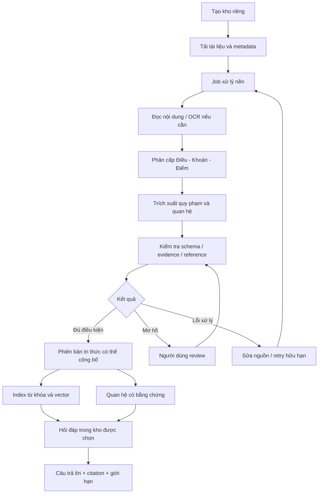
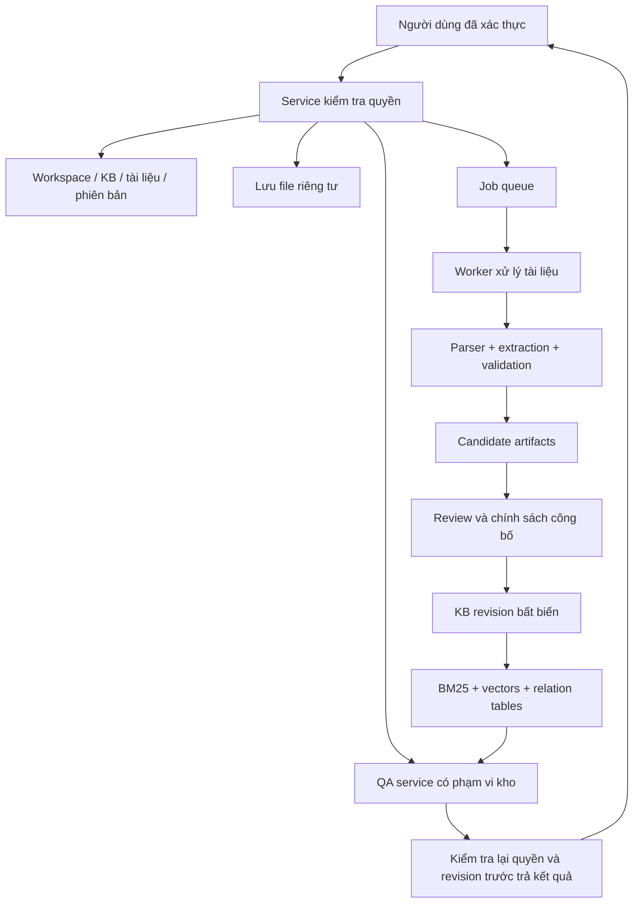
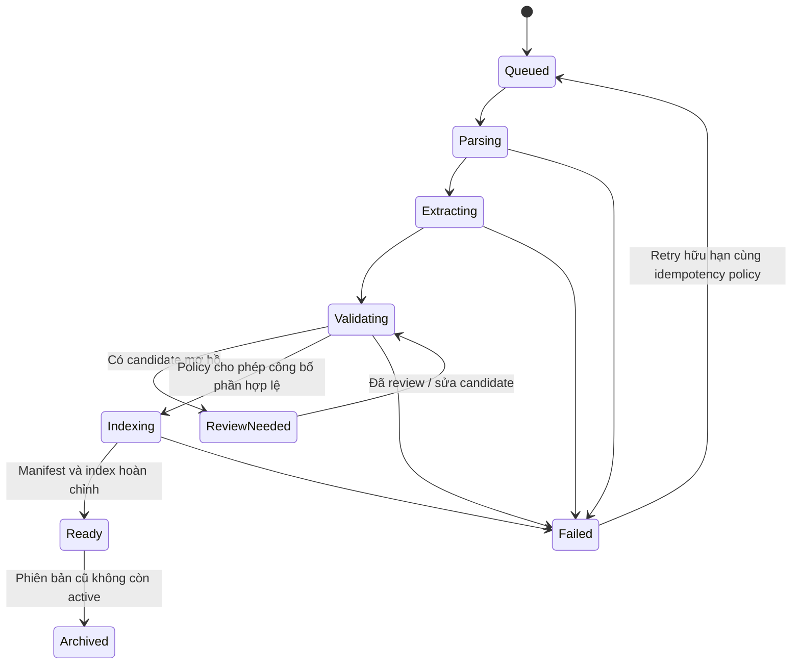

# F-KB-01 — Kho tri thức pháp lý riêng cho luật sư

Ngày cập nhật: 01/11/2026. Trạng thái: yêu cầu sản phẩm đã được ghi nhận; phạm vi và kiến trúc dưới đây là thiết kế đề xuất, chưa triển khai. Tài liệu này chưa thay đổi lịch triển khai hoặc backlog Jira.

## 1. Mô tả tính năng

Luật sư tạo kho tri thức pháp lý riêng bằng cách tải tài liệu lên. Hệ thống phân tích cấu trúc, trích xuất quy phạm và quan hệ có bằng chứng, cho phép kiểm tra/chỉnh sửa kết quả, sau đó tra cứu và hỏi đáp có dẫn nguồn trong kho đã chọn.

Tên giao diện đề xuất: **Kho tri thức**. Đơn vị quản lý sản phẩm: workspace → knowledge base → documents → versions. Không gọi việc tải tài liệu lên là huấn luyện model; xử lý tài liệu, lập chỉ mục và cập nhật KB không yêu cầu fine-tune.

Tính năng tái sử dụng parser, extraction, validation, indexing và RAG trong [thiết kế kỹ thuật](../planning/technical-design-plan.md), đồng thời bổ sung quản lý kho, quyền truy cập, upload, job nền, phiên bản và review. MVP hiện tại trong [kiến trúc](../architecture.md) mới dùng corpus do nhóm chuẩn bị; chưa có các khả năng quản lý kho riêng này.

## 2. Vấn đề và giá trị sử dụng

- Luật sư có tài liệu phân tán, cần tìm đúng căn cứ mà không đọc lại toàn bộ hồ sơ.
- Các Điều/Khoản/Điểm liên quan nhau qua dẫn chiếu, định nghĩa, điều kiện và ngoại lệ; tìm kiếm từ khóa đơn lẻ khó thể hiện đầy đủ.
- Câu trả lời cần truy nguyên về đúng đoạn tài liệu và phiên bản, thay vì chỉ có đoạn diễn giải của AI.
- Kho phải cập nhật được khi thêm bản mới, thu hồi tài liệu hoặc sửa kết quả trích xuất.

Giá trị cần chứng minh: giảm thời gian tìm căn cứ, giữ đúng điều kiện/ngoại lệ và giúp người dùng kiểm tra kết quả. Việc upload rồi chat tự thân đã có trên thị trường; chất lượng bóc tách pháp luật Việt Nam và provenance là hướng khác biệt cần đánh giá thực tế.

## 3. Đối tượng và phạm vi nguồn

Người dùng chính: luật sư hoặc chuyên viên pháp lý tự quản lý một bộ tài liệu. Mở rộng sau: văn phòng luật có thành viên được phân quyền và kho hồ sơ theo vụ việc.

| Loại nguồn | Vai trò trong hệ thống | Chính sách biểu diễn |
|---|---|---|
| Văn bản pháp luật | Căn cứ quy định | Có mã văn bản, cấu trúc, metadata hiệu lực có nguồn hoặc unknown |
| Hợp đồng/hồ sơ | Tình tiết, nội dung thỏa thuận | Ghi source type và phạm vi vụ việc; không coi là quy định pháp luật |
| Ghi chú/ý kiến luật sư | Nhận định chuyên môn của người dùng | Gắn tác giả và trạng thái; không biến thành quy phạm |

Phiên bản nhỏ đầu tiên tập trung văn bản pháp luật lao động và PDF có text. Hợp đồng, hồ sơ và ghi chú là hướng mở rộng cần schema riêng. Tài liệu tải lên không tự được coi là nguồn chính thống hoặc còn hiệu lực.

## 4. Các mức năng lực

| Mức | Hành vi | Hướng Lexora |
|---|---|---|
| Hỏi đáp tài liệu | Upload → chia đoạn → tìm đoạn → trả lời | Lớp nền |
| Kho có cấu trúc | Nhận diện đơn vị pháp luật, quy phạm, điều kiện, ngoại lệ, dẫn chiếu | Trọng tâm tính năng |
| Kho có quản trị | Phân quyền, phiên bản, review, cập nhật/xóa, audit | Làm tối thiểu cần thiết ngay từ đầu; mở rộng dần |

Graph là một biểu diễn dữ liệu. Có thể lưu cạnh bằng bảng SQLite trước khi cần graph database. Màn hình graph không thay thế khả năng đọc bảng quan hệ và mở bằng chứng.

## 5. Hành trình người dùng

1. Tạo kho, nhập tên, mô tả và lĩnh vực; mặc định riêng tư.
2. Tải tài liệu, khai báo loại nguồn, tên/mã và phiên bản nếu biết. Trường chưa xác minh giữ unknown.
3. Xem tiến độ từng tài liệu: chờ xử lý, đọc nội dung, bóc tách, kiểm tra, sẵn sàng hoặc cần review/lỗi.
4. Xem cấu trúc Điều/Khoản/Điểm, các quy phạm và quan hệ đã trích; mỗi mục mở được đoạn nguồn.
5. Duyệt hoặc sửa kết quả mơ hồ; bản máy trích và bản người dùng sửa được giữ riêng.
6. Chọn kho và đặt câu hỏi; câu trả lời chỉ dùng dữ liệu được phép và trạng thái công bố phù hợp.
7. Bấm citation để xem nguyên văn, tài liệu, phiên bản, điều kiện và ngoại lệ.
8. Thêm phiên bản mới hoặc xóa tài liệu; hệ thống cập nhật các chỉ mục và quan hệ phụ thuộc.

## 6. Phạm vi phiên bản nhỏ đề xuất

### Bắt buộc

- Tạo, xem, đổi tên và xóa kho thuộc quyền của người dùng đã xác thực.
- Upload một tập PDF có text; kiểm tra loại/kích thước/số lượng theo cấu hình, không giả định dung lượng vô hạn.
- Có danh sách tài liệu, trạng thái job, lỗi và nút retry khi phù hợp.
- Phân tích cấu trúc pháp luật và trích xuất theo schema dùng chung.
- Lưu cấu trúc, dẫn chiếu và quy phạm có evidence; hiển thị bằng bảng quan hệ kèm nguồn.
- Hiển thị các mục needs_review; người dùng có thể duyệt/sửa, lưu lịch sử quyết định.
- Tìm kiếm và hỏi đáp trong một kho riêng đang được chọn, citation đúng phiên bản.
- Cô lập dữ liệu giữa các người dùng/kho; cập nhật và xóa phải loại dữ liệu khỏi truy xuất.

### Làm sau khi luồng lõi ổn định

- Graph tương tác để xem quan hệ giữa Điều/Khoản/văn bản.
- Chia sẻ kho cho nhóm với vai trò owner/editor/viewer.
- Kết hợp kho pháp luật dùng chung và kho riêng; nguồn phải phân biệt rõ trong context/câu trả lời.
- OCR scan, DOCX và tài liệu đa định dạng sau khi kiểm tra parser/source mapping.
- So sánh phiên bản, gợi ý quan hệ sửa đổi có review, đồng bộ nguồn bên ngoài.

Không đưa vào MVP này: tự xác nhận hiệu lực mọi văn bản, suy luận pháp lý đầy đủ, tự giải quyết mọi xung đột văn bản, huấn luyện LLM riêng cho mỗi kho hoặc cho AI tự tạo quan hệ không có bằng chứng.

## 7. Các màn hình

| Màn hình | Nội dung chính | Hành động |
|---|---|---|
| Danh sách kho | Tên, lĩnh vực, số tài liệu, tình trạng xử lý | Tạo/mở/quản lý kho |
| Chi tiết kho | Tài liệu, phiên bản, nguồn, job và lỗi | Upload, retry, xem nguồn, xóa |
| Tri thức đã bóc tách | Cấu trúc, quy phạm, quan hệ và trạng thái | Lọc, mở evidence, review |
| Review | Candidate, quote, đoạn ngữ cảnh và lý do kiểm tra | Chấp nhận, từ chối, sửa có lý do |
| Hỏi đáp | Kho đang dùng, câu hỏi, câu trả lời và citations | Hỏi, bổ sung dữ kiện, mở nguồn |
| Quan hệ | Bảng cạnh; graph sau | Chọn quan hệ và xem bằng chứng |

Không hiển thị graph khi chưa có dữ liệu thật rồi khiến người dùng tưởng hệ thống đã suy ra quan hệ. Mỗi cạnh cần loại quan hệ và nguồn, không chỉ đường nối giữa các từ.

## 8. Kiến trúc triển khai

Một codebase Python theo module như plan hiện tại. UI/service nhận request ngắn; worker xử lý file ngoài vòng request. Có thể dùng bảng job SQLite và một worker đơn tiến trình trước khi cần hệ thống queue chuyên dụng.

Mỗi lần build index dùng artifact tạm; chỉ chuyển active revision khi index và manifest đầy đủ. Lỗi giữa chừng không thay active index bằng bản chưa hoàn thành. Với corpus nhỏ, SQLite + JSONL + exact vector search đủ để kiểm tra trước; Neo4j là lựa chọn sau khi có nhu cầu traversal và số đo.

## 9. Hợp đồng dữ liệu bổ sung

Mở rộng [data-contracts.md](../data-contracts.md) bằng migration có phiên bản khi thực sự triển khai; bảng dưới chưa thay schema runtime hiện có.

| Đối tượng | Trường đề xuất | Ràng buộc |
|---|---|---|
| Workspace | workspace_id, owner_id, name | Owner lấy từ phiên xác thực, không tin owner do client tự gửi |
| KnowledgeBase | knowledge_base_id, workspace_id, name, domain, active_revision_id | Chỉ mở revision thuộc chính kho đó |
| Membership | workspace_id, user_id, role | Dùng khi mở chia sẻ; MVP owner-only vẫn có kiểm tra quyền |
| Document | document_id, workspace_id, knowledge_base_id, source_type, title | Không lẫn nguồn pháp luật với hồ sơ/nhận định |
| DocumentVersion | version_id, document_id, source_sha256, storage_key, metadata_provenance | Snapshot và mapping bất biến; không chỉ dựa vào filename |
| ProcessingJob | job_id, version_id, stage, status, attempts, config_hash, error | Idempotency, checkpoint, retry hữu hạn |
| NormClaim / Relation | workspace_id, knowledge_base_id, version_id, evidence_ids, extraction_run_id | Kế thừa điều kiện/ngoại lệ và lineage của schema hiện có |
| ReviewDecision | candidate_id, reviewer_id, decision, corrected_payload, reason, timestamp | Không ghi đè raw model output; sửa nội dung phải validate lại |
| KBRevision | revision_id, knowledge_base_id, input_versions, policy_hash, index_manifest | Active snapshot truy được toàn bộ nguồn và cấu hình |
| AnswerTrace | answer_id, user_id, knowledge_base_id, revision_id, evidence_ids | Citation phải thuộc revision và phạm vi người dùng được phép |

Các hàng dùng evidence/relationships cần khóa hoặc kiểm tra tham chiếu có đủ scope; một ID tồn tại trong hệ thống chưa chứng minh nó thuộc đúng kho. Evidence tiếp tục dùng Unicode code point `[start,end)`, exact quote và normalized hash.

## 10. Quan hệ cần dựng và thuật toán

| Loại | Cách xác lập | Giới hạn |
|---|---|---|
| PART_OF | Parser phân cấp cấu trúc | Không suy từ từ khóa xuất hiện trong thân |
| REFERENCES | Rule phát hiện dẫn chiếu + resolver theo mã văn bản/path | Mơ hồ thì pending/external; không tạo đích giả |
| DEFINES | Rule + LLM trích thuật ngữ/định nghĩa | Quote và vị trí nguồn bắt buộc |
| NormClaim | Structured extraction actor/modality/action/conditions/exceptions | Không rút gọn mất phủ định, AND/OR, số/đơn vị |
| AMENDS / REPLACES | Evidence trực tiếp xác định phần sửa/thay | Không suy chỉ từ ngày mới hơn hoặc chủ đề giống nhau |
| EXCEPTION_TO | Trích ngoại lệ và đích áp dụng có nguồn | Không coi similarity là quan hệ ngoại lệ |

Pipeline đề xuất: parse cấu trúc → tìm dẫn chiếu xác định → LLM trích claims/slot quotes → align quote → schema/ref/evidence validation → phân loại accepted/rejected/needs_review → review → dựng revision/index.

Entity resolution ưu tiên mã văn bản, structural path và alias có nguồn. Embedding similarity chỉ gợi ý đồng nhất; không tự gộp hai tài liệu/khái niệm pháp lý. Dedup theo hash trong phạm vi được phép; cùng bytes không cho phép chia sẻ nội dung private giữa các tenant.

Không yêu cầu model tự đếm offset. Model trả unit ID/quote; chương trình align về bản chuẩn hóa. Quote mơ hồ phải review. Trích xuất đúng định dạng và quote tồn tại chưa bảo đảm diễn giải pháp lý đúng; cần đo semantic errors riêng.

## 11. Trạng thái xử lý và công bố

Trạng thái job khác trạng thái pháp lý của văn bản và quyết định validation của từng claim. Ready chỉ nghĩa có artifact sẵn sàng theo policy, không nghĩa mọi quan hệ đã được luật sư duyệt hoặc văn bản còn hiệu lực.

Nếu chỉ một phần dữ liệu hợp lệ, policy phải quyết định công bố phần đó hay chờ review. UI báo rõ phần chưa dùng; không âm thầm coi thiếu claim là tài liệu không có quy định đó. Duyệt thủ công không thể bỏ qua hard failure về hash/offset/quyền truy cập.

## 12. Quyền truy cập và phân biệt nguồn

- Kiểm tra `workspace_id` và quyền kho ở backend trước search, retrieval, traversal, source viewer, download và trả câu trả lời.
- Namespace mọi file, index, cache, job và artifacts theo scope; không dùng cache dùng chung chỉ có question text làm key.
- Worker kiểm tra kho/version chưa bị thu hồi trước khi ghi và publish, tránh job cũ khôi phục dữ liệu đã xóa.
- Graph traversal không đi qua node/cạnh ngoài scope, kể cả khi vector candidates đã được lọc.
- Khi mở chia sẻ, thu hồi quyền phải có hiệu lực với nguồn, lịch sử trả lời và link tải, không chỉ màn hình danh sách kho.
- Phân quyền thuộc ứng dụng, không nhất thiết phải dựng microservice hoặc database riêng cho từng người dùng trong MVP.

Chế độ hỏi đáp đầu tiên chỉ dùng kho riêng đã chọn. Chế độ kết hợp kho chung/private sau phải gắn nhãn nguồn rõ ràng, thực hiện hợp quyền từng nguồn và giữ provenance trong câu trả lời. Không nhập nội dung kho riêng vào corpus công khai hoặc bộ evaluation chung mặc định.

## 13. Phiên bản, cập nhật và xóa

File mới được kiểm tra hash để tránh xử lý lặp trong cùng scope. Không tự nhận hai file cùng tên là cùng văn bản hoặc thay thế pháp lý. Người dùng liên kết chúng thành phiên bản khi có căn cứ; quan hệ phiên bản kỹ thuật khác quan hệ sửa đổi pháp luật.

Thay đổi text/normalization làm lại evidence và những stage phụ thuộc; thay prompt extraction chỉ làm lại extraction trở đi; thay embedding làm lại dense index. Cache key gồm scope, source hashes, schema, model/revision, tokenizer/template, prompt và config hashes.

Khi xóa: chặn truy cập/truy xuất ngay bằng tombstone hoặc revoked scope → hủy/khóa publish job còn chạy → loại khỏi active revision/index/graph/cache → xử lý file và artifacts theo chính sách lưu giữ đã công bố. Citation lịch sử tới nguồn bị xóa hiển thị “nguồn không còn khả dụng”, không tự chuyển sang phiên bản khác.

Audit log có thể giữ metadata sự kiện theo policy, nhưng không giữ toàn văn tài liệu trong log với lý do audit. Backups cần retention và quy trình hết hạn; không tuyên bố xóa vật lý mọi bản sao tức thì nếu chưa thực hiện được.

## 14. Vận hành trên Lightning Free

Upload/metadata/job state chạy CPU; trích xuất/embedding chạy batch khi có GPU. Cache theo hash, checkpoint mỗi batch, giới hạn concurrency và tổng tài liệu/trang/token theo config. Quota thực cần kiểm tra trong tài khoản; chưa có số đo thì không đặt lời hứa thời gian xử lý.

Nếu hết GPU/quota: job có trạng thái chờ tài nguyên/lỗi rõ ràng, người dùng vẫn xem dữ liệu đã ready. Không nhận kết quả dựng sẵn là extraction thật và không tự chuyển dịch vụ trả phí. OCR scan và upload hàng loạt nên làm sau pilot PDF có text.

## 15. Tiêu chí nghiệm thu và đánh giá

| Nhóm | Ca nghiệm thu |
|---|---|
| Tạo kho | Người dùng tạo/mở đúng kho của mình; kho mới mặc định riêng tư |
| Upload | File hợp lệ vào đúng kho; file lỗi/quá hạn mức có thông báo; duplicate không tạo job dư |
| Parsing | Giữ cấu trúc và nội dung trên fixture pháp luật, test Unicode/source mapping |
| Extraction | Quy phạm giữ qualifiers; mọi cạnh/slot quan trọng có evidence hợp lệ |
| Review | Bản máy/bản sửa tách biệt, có reviewer/time/reason; sửa sai evidence không được publish |
| Truy xuất | Query đúng kho/revision; graph traversal và cache không vượt scope |
| Citation | Mở đúng nguồn/phiên bản/quote; không tạo citation ngoài context |
| Cô lập | Hai tài khoản/hai kho không đọc chéo qua ID đoán được, search, graph, cache hoặc download |
| Cập nhật | Build lỗi không thay active revision; job retry/resume không tạo trùng claims |
| Xóa/thu hồi | Không tiếp tục retrieval hoặc publish từ nguồn đã revoked; historical citation không tự đổi nguồn |
| Runtime | Restart/quota/timeout được báo; không bỏ job âm thầm hoặc tự dùng API trả phí |

Đo thêm số lần phải sửa kết quả extraction, tỷ lệ needs_review, thời gian xử lý, tỷ lệ truy xuất đủ căn cứ và khả năng người dùng kiểm tra citation. Không đánh giá chất lượng bằng số node/edge nhiều hay hình graph đẹp.

Review tạo nhánh curated riêng. Không đưa sửa thủ công vào ĐK4 rồi vẫn so với ĐK3 như thí nghiệm validation tự động. Bộ câu hỏi/corpus nghiên cứu đã freeze tiếp tục độc lập với dữ liệu người dùng tải lên.

## 16. Các gói triển khai đề xuất

| Gói | Đầu ra | Người chính đề xuất | Phụ thuộc |
|---|---|---|---|
| FKB-01 | Workspace/KB metadata, xác thực, owner-only scope | Vũ; Kha review schema | Chốt auth/session và schema |
| FKB-02 | Upload, storage riêng tư, job state/retry/checkpoint | Vũ | FKB-01 và ingestion hiện có |
| FKB-03 | Scoped parser/extraction/validation và quan hệ có evidence | Kha | FKB-02, schema v1, pipeline lõi |
| FKB-04 | Bảng tri thức/review, raw/curated, revision publication | Kha + Vũ | FKB-03 |
| FKB-05 | Hỏi đáp theo kho và source viewer có kiểm tra quyền | Vũ | FKB-04, RAG lõi |
| FKB-06 | Cập nhật/xóa/invalidation và kiểm thử cô lập/resume | Cả hai | Thiết kế cùng FKB-01; bắt buộc trước release FKB-05 |
| FKB-07 | Graph tương tác, chia sẻ nhóm, OCR và combined search | Sau MVP | Có benchmark/capacity và quyết định phạm vi |

Các mã FKB là gói thiết kế local, chưa phải Jira issue. Chưa đặt deadline/estimate để tránh tự mở rộng lịch hai người đến 20/12. Trước khi đưa vào kế hoạch thực thi cần chốt phần thay thế/giảm của backlog hiện tại hoặc nguồn lực bổ sung. Không tự cập nhật Jira/GitHub từ tài liệu này.

## 17. Điểm cần chốt trước triển khai

1. Phiên bản đầu chỉ nhận văn bản pháp luật hay cả hợp đồng/hồ sơ vụ việc? Đề xuất bắt đầu với văn bản lao động có text.
2. Kho owner-only trước hay chia sẻ theo văn phòng ngay? Đề xuất owner-only nhưng thiết kế scope ngay từ đầu.
3. Có thể công bố phần accepted trong khi còn needs_review không? Phải hiện coverage và policy, không che phần thiếu.
4. Giới hạn file/trang/dung lượng/job dựa trên quota và pilot thực tế; chưa cam kết số lượng.
5. Auth/session, nơi lưu file và chính sách retention/deletion nào được chọn?
6. Tính năng này thay thế phần nào trong lịch cũ nếu vẫn giữ hạn và nhân sự?

## 18. Sản phẩm và tài liệu tham khảo

Đối chiếu trong cuộc trao đổi ngày 01/11/2026. Đây là mô tả khả năng được công bố, không khẳng định kiến trúc nội bộ của sản phẩm đóng.

- [Harvey Vault](https://www.harvey.ai/platform/vault): lưu trữ, tổ chức, phân tích tài liệu và xây knowledge base cho tổ chức. Không dùng thông tin này để kết luận Harvey có pipeline graph giống Lexora.
- [CoCounsel Knowledge Search](https://www.thomsonreuters.com/en-us/help/cocounsel/legal/integrations/knowledge-search-integration/knowledge-search): tìm nội dung trong nguồn nội bộ/DMS và đưa tài liệu vào chat để phân tích.
- [Neo4j LLM Knowledge Graph Builder](https://neo4j.com/developer/genai-ecosystem/llm-graph-builder/): tài liệu → lexical/entity graphs → hỏi đáp bằng các cách retrieval; có schema cấu hình và thao tác làm sạch. Chất lượng tiếng Việt pháp luật vẫn phải kiểm tra riêng.
- [Microsoft GraphRAG Dataflow](https://microsoft.github.io/graphrag/index/default_dataflow/): text units, entity/relationship extraction, communities, reports và embeddings. Community summarization không bắt buộc cho phạm vi nhỏ của Lexora.
