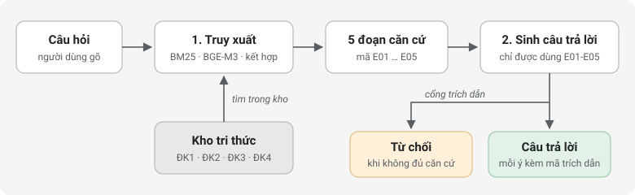
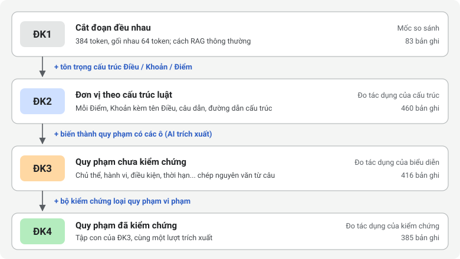
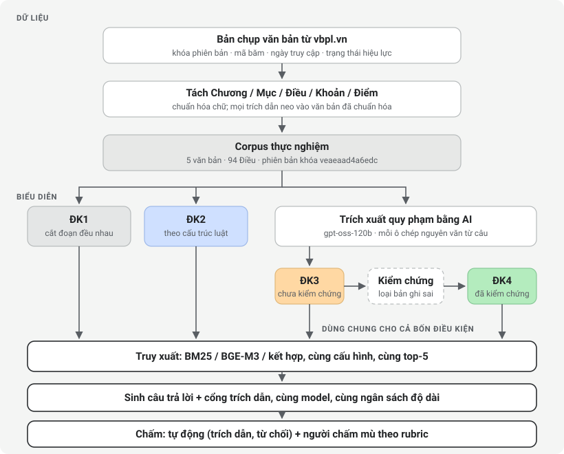

## Lexora trong một phút

Lexora là hệ thống hỏi đáp pháp luật lao động Việt Nam, trả lời **kèm trích dẫn tới đúng câu luật** và biết **từ chối** khi không đủ căn cứ.
Đây là đồ án tốt nghiệp "Nghiên cứu và xây dựng hệ thống hỏi đáp pháp luật dựa trên RAG với Legal Knowledge Base có cấu trúc và kiểm chứng".

Câu hỏi đề tài muốn trả lời:

> Nếu tổ chức luật thành **kho tri thức có cấu trúc, có bằng chứng nguyên văn và được kiểm chứng**, hệ thống hỏi đáp có trả lời đúng hơn, trích dẫn chuẩn hơn so với cách làm thông thường là cắt văn bản thành đoạn không?

Để trả lời, đề tài so sánh **bốn cách tổ chức dữ liệu (ĐK1-ĐK4)** trên cùng một bộ luật, cùng một bộ câu hỏi, cùng một model.
Kết quả được báo cáo trung thực, kể cả khi không ủng hộ giả thuyết.

## 1. Bài toán: vì sao hỏi đáp luật khó

Một nhân viên nhân sự hỏi: *"Trả lương thử việc 80% có được không?"*

Để trả lời đúng cần:

1. **Tìm đúng quy định**: Điều 26 Bộ luật Lao động 2019 nói lương thử việc "ít nhất phải bằng 85% mức lương của công việc đó".
2. **Không bỏ sót văn bản khác**: Nghị định 12/2022 Điều 10 phạt 2 đến 5 triệu đồng nếu trả thấp hơn 85%.
3. **Không bịa**: không tự thêm ngoại lệ hay con số luật không nói.
4. **Cho người hỏi kiểm tra lại**: chỉ ra đúng câu luật làm căn cứ.

Khó ở chỗ:

| Đặc điểm của luật | Hệ quả |
|---|---|
| Một vấn đề nằm rải rác ở Bộ luật, nghị định, thông tư | Phải gom nhiều văn bản mới trả lời đủ |
| Văn bản có cấu trúc Điều, Khoản, Điểm; nhiều điểm chỉ có nghĩa khi đọc cùng câu dẫn | Cắt sai chỗ là mất nghĩa |
| Văn bản được sửa đổi, thay thế theo thời gian | Cùng câu hỏi, năm khác có thể có đáp án khác |
| Câu chữ chính xác quan trọng ("phải", "được", "không được", "trừ trường hợp") | Diễn đạt lại sai một chữ là sai luật |

Hỏi thẳng một model ngôn ngữ (như ChatGPT) thì câu trả lời nghe rất trôi chảy nhưng có thể:

- dựa trên luật cũ (Bộ luật Lao động 2012) hoặc luật nước khác;
- bịa số liệu, ví dụ "thử việc tối đa 90 ngày" cho mọi công việc;
- không cho biết căn cứ ở đâu để kiểm tra.

## 2. RAG: cho model "đọc tài liệu" trước khi trả lời

**RAG (Retrieval-Augmented Generation)** chia việc trả lời thành hai bước:



Model không cần "nhớ" luật; nó đọc các đoạn được tìm ra và tóm lại.
Vì vậy chất lượng câu trả lời phụ thuộc rất nhiều vào **kho được tổ chức thế nào** và **tìm có trúng không**.
Đó chính là chỗ đề tài nghiên cứu.

Trong Lexora:

- **Truy xuất** dùng BM25 (tìm theo từ khóa), BGE-M3 (tìm theo nghĩa, chạy trên máy) hoặc kết hợp cả hai.
- **Sinh** dùng một model cố định, với luật lệ chặt: chỉ dùng đoạn căn cứ, giữ nguyên điều kiện và ngoại lệ, không khẳng định hiệu lực nếu đoạn không nói.
- **Cổng trích dẫn** bỏ mọi ý không có trích dẫn hợp lệ; không còn ý nào thì hệ thống từ chối.

## 3. Vấn đề của cách làm thông thường

Cách phổ biến nhất là **cắt văn bản thành các đoạn dài bằng nhau** (ví dụ 384 token, gối nhau 64 token) rồi tìm trên các đoạn đó.
Đơn giản, áp dụng cho mọi loại tài liệu, nhưng với luật thì:

- đoạn cắt ngang Điều, Khoản: một đoạn chứa cuối Điều này và đầu Điều khác;
- câu trả lời chỉ một dòng nhưng phải gửi cho model cả đoạn dài, lẫn nhiều quy định không liên quan;
- điểm a, b, c bị tách khỏi câu dẫn, đọc riêng không hiểu.

Ví dụ thật trong corpus: đoạn chứa Điều 26 (lương thử việc) dài 384 token, bắt đầu từ cuối Điều 22, đi qua Điều 23, 24, 25, 26 và **dừng giữa câu** ở Điều 27 ("Trường hợp thử việc").

## 4. Hướng tiếp cận của đề tài

Thay vì chỉ cắt đoạn, đề tài biến luật thành **kho tri thức (Knowledge Base) gồm các quy phạm có cấu trúc**, mỗi phần có **bằng chứng nguyên văn**, rồi **kiểm chứng tự động** trước khi dùng.

### Quy phạm là gì

**Quy phạm** là một quy tắc xử sự: ai phải, được hoặc không được làm gì, trong điều kiện nào.
Ví dụ, Điều 27 khoản 1: *"Khi kết thúc thời gian thử việc, người sử dụng lao động phải thông báo kết quả thử việc cho người lao động."*

| Ô | Giá trị (chép nguyên văn từ câu) |
|---|---|
| Tính quy phạm | Nghĩa vụ (từ "phải") |
| Chủ thể | người sử dụng lao động |
| Hành vi | thông báo |
| Đối tượng | kết quả thử việc |
| Bên nhận | người lao động |
| Điều kiện | Khi kết thúc thời gian thử việc |

### Bằng chứng nguyên văn

Mỗi ô phải là cụm từ **có thật** trong câu luật; hệ thống lưu vị trí ký tự và mã băm của văn bản gốc.
Nhờ vậy người dùng bấm vào là mở đúng chỗ trong luật, và máy kiểm tra được ô nào bịa.

### Trích xuất bằng AI và kiểm chứng

Làm tay cho hàng trăm câu luật thì rất lâu, nên dùng model (gpt-oss-120b) **trích xuất** quy phạm.
Nhưng model có thể sai: bịa chữ, nhầm chủ thể, nhầm "phải" thành "có quyền".
Vì vậy có **bộ kiểm chứng** tự động loại các quy phạm vi phạm:

| Kiểm tra | Loại khi |
|---|---|
| Cấu trúc | Thiếu ô bắt buộc, sai kiểu dữ liệu |
| Toàn vẹn | Trỏ tới đơn vị luật không tồn tại hoặc sai phiên bản |
| Nguyên văn | Có ô không nằm nguyên văn trong câu |
| Từ tình thái | Từ tình thái bịa, hoặc mâu thuẫn với loại quy phạm (ví dụ "phải" mà ghi Quyền) |
| Trùng lặp | Hai quy phạm giống hệt nhau |

Trong ứng dụng thật, người duyệt (pháp chế) còn xem và duyệt từng quy phạm trước khi công bố cho người tra cứu.

## 5. So sánh phương pháp truyền thống với cách làm của nhóm

### Các cách đang được dùng

| Cách làm | Mô tả | Ví dụ |
|---|---|---|
| A. Tra cứu thủ công | Người dùng tự tìm văn bản, tự đọc, tự tổng hợp | Thư viện pháp luật, cổng vbpl.vn, hỏi luật sư |
| B. Tìm kiếm theo từ khóa | Gõ từ khóa, nhận danh sách văn bản hoặc Điều khớp chữ | Ô tìm kiếm của các trang văn bản pháp luật |
| C. Hỏi thẳng chatbot | Model ngôn ngữ trả lời từ những gì nó "nhớ" khi huấn luyện | ChatGPT, Gemini dùng không kèm tài liệu |
| D. RAG thông thường | Cắt văn bản thành đoạn đều nhau, tìm đoạn liên quan, cho model trả lời từ đó | Đa số chatbot "hỏi đáp tài liệu" hiện nay; trong đề tài là ĐK1 |
| E. Cách làm của nhóm (Lexora) | Tổ chức luật thành quy phạm có cấu trúc, có bằng chứng nguyên văn, được kiểm chứng và người duyệt; RAG trên kho đó, có cổng trích dẫn và từ chối | ĐK2-ĐK4 và ứng dụng Lexora |

### So sánh theo tiêu chí

| Tiêu chí | A. Thủ công | B. Từ khóa | C. Chatbot | D. RAG thông thường | E. Lexora |
|---|---|---|---|---|---|
| Trả lời thẳng câu hỏi | Có, sau khi tự đọc | Không, chỉ ra văn bản | Có | Có | Có |
| Căn cứ chỉ tới đúng câu luật | Có, nếu người đọc kỹ | Tới Điều hoặc văn bản | Không, hoặc dẫn sai | Tới một đoạn dài, có thể lẫn nhiều Điều | Tới đúng khoản, điểm, câu; bấm là mở nguyên văn |
| Kiểm tra lại được | Có | Có | Khó | Được, nhưng phải đọc cả đoạn | Được, từng ý có mã trích dẫn |
| Nguy cơ bịa | Thấp | Không có (không trả lời) | Cao | Trung bình: model vẫn có thể thêm ý ngoài đoạn | Thấp hơn: cổng trích dẫn bỏ ý không có căn cứ, thiếu căn cứ thì từ chối |
| Gom nhiều văn bản (luật, nghị định, thông tư) | Có, tốn công | Phải tự gom | Không chắc chắn | Có nếu tìm trúng | Có; câu hỏi tổng hợp là một loại câu được đo riêng |
| Luật đổi thì sao | Tự theo dõi | Phụ thuộc trang | Phải chờ huấn luyện lại, dễ dùng luật cũ | Cập nhật kho | Cập nhật kho; mỗi văn bản có ngày truy cập, hiệu lực và phiên bản khóa |
| Biết nói "không biết" | Có | Không áp dụng | Hiếm khi | Ít khi | Có: từ chối khi không đủ căn cứ, và được đo bằng tỉ lệ từ chối đúng |
| Công sức dựng | Không | Thấp | Không | Thấp | Cao hơn: cần trích xuất bằng AI, kiểm chứng, người duyệt |
| Công sức mỗi lần hỏi | Rất cao | Cao | Rất thấp | Thấp | Thấp |

### Cùng một câu hỏi, năm cách làm

Câu hỏi: **"Công ty trả lương thử việc 80% có được không?"**

| Cách làm | Điều thường xảy ra |
|---|---|
| A. Thủ công | Mở Bộ luật Lao động, tìm tới Điều 26 (ít nhất 85%); nếu biết thì tìm thêm Nghị định 12/2022 về mức phạt. Đúng nhưng mất nhiều phút và cần biết tìm ở đâu. |
| B. Từ khóa | Gõ "lương thử việc" ra nhiều kết quả: Điều 24, 25, 26, 27 Bộ luật Lao động, Điều 10 Nghị định 12/2022... Người dùng vẫn phải tự đọc và kết luận. |
| C. Chatbot | Trả lời trôi chảy "không được, tối thiểu 85%", có thể đúng, nhưng có thể dẫn nhầm Bộ luật Lao động 2012, không chỉ ra câu luật, không nhắc mức phạt; không có cách kiểm tra. |
| D. RAG thông thường | Tìm được đoạn 384 token chứa Điều 22-27; model trả lời được 85% nhưng căn cứ là cả đoạn dài; mức phạt ở Nghị định 12/2022 có thể không lọt vào 5 đoạn được chọn vì mỗi đoạn chiếm nhiều chỗ. |
| E. Lexora | Tìm được bản ghi Điều 26 (35 token) và điểm c khoản 2 Điều 10 Nghị định 12/2022 (phạt 2-5 triệu nếu trả thấp hơn 85%); câu trả lời gồm hai ý, mỗi ý ghi mã trích dẫn mở đúng câu luật. Nếu kho không có căn cứ, hệ thống nói không đủ căn cứ thay vì đoán. |

Cột E mô tả cách hệ thống được thiết kế để hoạt động.
Nó có thực sự tốt hơn cột D hay không là câu hỏi RQ3, sẽ được đo bằng số liệu trên 152 câu hỏi, không phải khẳng định sẵn.

### Điểm mới của cách làm nhóm

1. **Đơn vị theo cấu trúc luật** thay vì đoạn cắt đều: không cắt ngang Điều, Khoản, giữ câu dẫn đi kèm các điểm.
2. **Quy phạm có các ô** (chủ thể, hành vi, điều kiện, ngoại lệ, thời hạn...) thay vì văn bản thô: máy biết ai phải làm gì.
3. **Bằng chứng nguyên văn tới từng ký tự**: mỗi ô gắn vị trí trong văn bản gốc, nên trích dẫn mở đúng chỗ và máy kiểm tra được chữ nào bịa.
4. **Bộ kiểm chứng tự động có đo lường**: không chỉ lọc, mà đo được nó bắt bao nhiêu lỗi (chèn lỗi có chủ đích) và loại nhầm bao nhiêu (bảng kiểm tra quy phạm bị loại).
5. **Người duyệt trước khi công bố** trong ứng dụng thật: mọi quy phạm do AI tạo chỉ là bản nháp cho tới khi pháp chế duyệt.
6. **Cổng trích dẫn và từ chối**: ý không có căn cứ bị bỏ, thiếu căn cứ thì từ chối.
7. **Thực nghiệm có đối chứng**: ĐK1-ĐK4 chỉ khác nhau một thay đổi mỗi bước, cùng bộ câu hỏi có tập held-out giữ kín, có công cụ kiểm tra công bằng trước khi báo cáo.

### Cái giá phải trả

Cách làm của nhóm không miễn phí:

- Dựng kho tốn công hơn: cần chạy AI trích xuất, kiểm chứng và người duyệt.
- AI trích xuất có thể sai; bộ kiểm chứng chỉ kiểm hình thức, không hiểu nghĩa.
- Quy tắc "nguyên văn theo câu" chặt có thể loại cả quy phạm đúng (ví dụ Điều 26 ở mục 7).
- Phạm vi thực nghiệm hiện là 94 Điều; mở rộng ra toàn bộ pháp luật lao động cần thêm công sức tương ứng.

Vì vậy đề tài giữ ĐK2 (chỉ cắt theo cấu trúc, không cần AI) làm một điều kiện riêng: nếu ĐK2 đã gần bằng ĐK4 thì cách rẻ hơn là lựa chọn hợp lý.

## 6. Bốn điều kiện ĐK1-ĐK4

### Ý tưởng: thay đổi từng thứ một

Giống thí nghiệm khoa học, mỗi điều kiện chỉ **thêm đúng một thay đổi** so với điều kiện trước.
Mọi thứ khác giữ nguyên: cùng 94 Điều luật, cùng 152 câu hỏi, cùng cách tìm, cùng model trả lời, cùng ngân sách độ dài.
Nhờ vậy, nếu kết quả khác nhau, ta biết **thay đổi nào gây ra khác biệt**.



Một công cụ riêng (`preflight`) kiểm tra trước khi báo cáo rằng bốn điều kiện thật sự chỉ khác nhau ở cách biểu diễn.

### Bảng so sánh

| | ĐK1 | ĐK2 | ĐK3 | ĐK4 |
|---|---|---|---|---|
| Kho chứa gì | Đoạn 384 token cắt đều | Điểm, Khoản (hoặc Điều không chia khoản), kèm đường dẫn "Chương > Điều > Khoản" | Quy phạm do AI trích xuất | Quy phạm của ĐK3 sau khi lọc |
| Số bản ghi (corpus thực nghiệm) | 83 | 460 | 416 | 385 |
| Cần AI để dựng kho | Không | Không | Có | Có, cộng bộ kiểm chứng |
| Câu hỏi nó trả lời | Cách làm phổ biến được bao nhiêu điểm? | Tôn trọng cấu trúc luật có giúp không? | Biểu diễn thành quy phạm có giúp không? | Lọc bỏ quy phạm sai có giúp không? |

### ĐK1: cắt đoạn đều nhau

**Là gì**: nối toàn bộ văn bản rồi cắt thành các đoạn 384 token, đoạn sau gối lên đoạn trước 64 token.
**Vì sao cần**: đây là cách hầu hết hệ thống RAG đang làm; không có ĐK1 thì không biết các cách khác hơn được bao nhiêu so với "mặc định".
**Nhược điểm**: đoạn cắt ngang quy định, mỗi đoạn dài và lẫn nội dung không liên quan.
**Nếu không có**: mọi so sánh chỉ là giữa các phương án của chính đề tài, không chứng minh được giá trị so với thực tế.

### ĐK2: đơn vị theo cấu trúc luật

**Là gì**: mỗi bản ghi là một Điểm, một Khoản, hoặc một Điều không chia khoản, kèm tên Điều, câu dẫn và đường dẫn cấu trúc.
**Vì sao cần**: tách riêng tác dụng của việc "cắt đúng chỗ" khỏi tác dụng của AI. Nếu ĐK2 đã tốt gần bằng ĐK3/ĐK4 thì không cần AI tốn kém.
**Ưu điểm**: rẻ, không cần model, không có lỗi trích xuất.
**Nhược điểm**: vẫn là văn bản thô, không biết câu nào là nghĩa vụ hay quyền, ai là chủ thể.
**Nếu không có**: không phân biệt được cải thiện đến từ cấu trúc văn bản hay từ AI trích xuất.

### ĐK3: quy phạm do AI trích xuất, chưa kiểm chứng

**Là gì**: model đọc từng câu luật và điền quy phạm vào các ô; mỗi quy phạm là một bản ghi để tìm.
**Vì sao cần**: đo xem biểu diễn có cấu trúc (ai, làm gì, khi nào) có giúp tìm và trả lời tốt hơn văn bản thô không.
**Nhược điểm**: AI có thể sai; quy phạm sai vẫn nằm trong kho.
**Nếu không có**: không có mốc "trước kiểm chứng" để đo bộ kiểm chứng có tác dụng hay không.

### ĐK4: quy phạm đã kiểm chứng

**Là gì**: chính ĐK3, sau khi bộ kiểm chứng loại các quy phạm vi phạm. ĐK4 luôn là tập con của ĐK3 và lấy từ cùng một lượt trích xuất.
**Vì sao cần**: đây là phương pháp đề tài đề xuất; so với ĐK3 để biết kiểm chứng giúp hay hại.
**Rủi ro**: bộ kiểm chứng có thể loại cả quy phạm đúng (xem ví dụ ở mục 7), làm kho thiếu căn cứ.
**Nếu không có**: không trả lời được giả thuyết chính của đề tài.

## 7. Một câu hỏi đi qua bốn điều kiện

Câu hỏi: **"Tiền lương thử việc ít nhất bằng bao nhiêu?"**
Căn cứ đúng: Điều 26 Bộ luật Lao động 2019, *"Tiền lương của người lao động trong thời gian thử việc do hai bên thỏa thuận nhưng ít nhất phải bằng 85% mức lương của công việc đó."*

Dưới đây là dữ liệu thật trong kho của từng điều kiện.

**ĐK1** tìm được một đoạn 384 token:

```
... ghi rõ nội dung điều, khoản sửa đổi, bổ sung và thời điểm có hiệu lực.
Điều 23. Hiệu lực của hợp đồng lao động ...
Điều 24. Thử việc ...
Điều 25. Thời gian thử việc ... (4 khoản)
Điều 26. Tiền lương thử việc
Tiền lương của người lao động trong thời gian thử việc do hai bên thỏa thuận
nhưng ít nhất phải bằng 85% mức lương của công việc đó.
Điều 27. Kết thúc thời gian thử việc
1. Khi kết thúc thời gian thử việc, người sử dụng lao động phải thông báo
kết quả thử việc cho người lao động. Trường hợp thử việc
```

Có câu trả lời, nhưng lẫn trong sáu Điều và kết thúc giữa câu.
Model phải tự lọc; năm đoạn như vậy chiếm gần hết ngân sách độ dài.

**ĐK2** tìm được một bản ghi 35 token:

```
Bộ Luật lao động số 45/2019/QH14
Chương III > Mục 1 > Điều 26
Điều 26. Tiền lương thử việc
Tiền lương của người lao động trong thời gian thử việc do hai bên thỏa thuận
nhưng ít nhất phải bằng 85% mức lương của công việc đó.
```

Gọn và đúng chỗ; còn chỗ cho các căn cứ khác (ví dụ mức phạt ở Nghị định 12/2022).

**ĐK3**: model gpt-oss-120b trích xuất từ Điều 26 quy phạm sau:

```
Tính quy phạm: nghĩa vụ (phải)
Chủ thể: hai bên
Hành vi: bằng
Đối tượng: 85% mức lương của công việc đó
Bên thụ hưởng: người lao động
Bên nhận: người lao động
Điều kiện: trong thời gian thử việc; do hai bên thỏa thuận
Định lượng: ít nhất
```

Có con số 85%, nhưng **chủ thể "hai bên" chưa chuẩn**: người phải trả đủ 85% là người sử dụng lao động.

**ĐK4**: bộ kiểm chứng **loại** quy phạm trên vì ô Điều kiện ghép hai cụm "trong thời gian thử việc" và "do hai bên thỏa thuận" bằng dấu chấm phẩy, không còn nguyên văn.
Kết quả: trong ĐK4 không còn quy phạm nào của Điều 26.

Ví dụ này cho thấy hai mặt của kiểm chứng:

- **Tốt**: một quy phạm có chủ thể chưa chuẩn bị loại khỏi kho.
- **Xấu**: lý do loại (ghép cụm từ) không phải lỗi nghiêm trọng, và câu hỏi về lương thử việc mất căn cứ trong ĐK4.

Vì vậy đề tài không chỉ đếm số quy phạm bị loại, mà còn **gán nhãn tay** xem bị loại có thật sự sai không (bảng kiểm tra quy phạm bị loại) và **đo câu trả lời cuối** của cả bốn điều kiện.

## 8. Ba câu hỏi nghiên cứu và cách đo

| Câu hỏi | Đo cái gì | Thước đo | Dữ liệu cần |
|---|---|---|---|
| **RQ1**: AI trích xuất quy phạm chính xác đến đâu? | So quy phạm của bộ quy tắc, ĐK3, ĐK4 với đáp án do người gán | Precision, Recall, F1 (khớp chặt và khớp lỏng) | Gold trích xuất: 290 câu luật của 40 Điều |
| **RQ2**: bộ kiểm chứng loại được bao nhiêu lỗi, còn sót bao nhiêu? | Chèn lỗi có chủ đích vào quy phạm đúng; gán nhãn tay quy phạm bị loại và được giữ | Tỉ lệ bắt lỗi; tỉ lệ sai trong nhóm bị loại và nhóm được giữ | Bảng kiểm tra 104 quy phạm |
| **RQ3**: cách tổ chức nào cho câu trả lời tốt hơn? | Chạy ĐK1-ĐK4 trên cùng bộ câu hỏi | Recall@K, độ chính xác trích dẫn, bám nguồn, độ đúng (người chấm), tỉ lệ từ chối đúng | Bộ câu hỏi 152 câu có nhãn, tập held-out giữ kín |

**Giả thuyết**: kho có cấu trúc và qua kiểm chứng giúp giảm lỗi trích dẫn và tăng mức bám nguồn so với RAG trên văn bản thô.

Vì sao cần **người gán nhãn**: máy không tự biết đúng sai; đáp án do hai người gán độc lập, đo độ đồng thuận bằng Cohen's kappa, rồi đối soát và chốt.
Chi tiết ở [Hướng dẫn gán nhãn](/docs/huong-dan-gan-nhan).

## 9. Toàn bộ quy trình



## 10. Dữ liệu và công nghệ

| Thành phần | Lựa chọn | Vì sao |
|---|---|---|
| Nguồn luật | vbpl.vn, chụp và khóa phiên bản | Nguồn chính thống; khóa để kết quả tái lập được |
| Phạm vi | Bộ luật Lao động 2019 và 4 văn bản hướng dẫn, 94 Điều | Đủ các chủ đề cốt lõi (hợp đồng, thử việc, tiền lương, thời giờ làm việc, kỷ luật) trong sức gán nhãn của hai người |
| Trích xuất | gpt-oss-120b (mã nguồn mở) qua 9Router; gemma4 để lặp lại; Opus 5.5 làm đối chứng | Đề cương ưu tiên model mở; gpt-oss phủ đủ câu, ít lỗi gọi |
| Tìm theo nghĩa | BGE-M3 chạy cục bộ | Mở, hỗ trợ tiếng Việt, không gửi dữ liệu ra ngoài |
| Lưu trữ | SQLite và tệp JSONL | Đơn giản, chạy được trên máy cá nhân, dễ tái lập |
| Ứng dụng | FastAPI + SvelteKit, chạy tại https://vlexora.duckdns.org | Người dùng thật (pháp chế, nhân sự) duyệt và tra cứu |

## 11. Ứng dụng có những gì

| Khu vực | Ai dùng | Làm gì |
|---|---|---|
| Tổng quan, Hỏi đáp | Mọi tài khoản | Hỏi và xem câu trả lời kèm trích dẫn trên các kho đã công bố |
| Nhập văn bản, duyệt | Người duyệt (pháp chế) | Nhập luật, tách quy phạm, duyệt từng quy phạm, công bố kho |
| Nghiên cứu | Người duyệt | Corpus, bộ câu hỏi, gold, kiểm tra quy phạm, kết quả thực nghiệm |
| Giám sát | Quản trị, tài khoản giám sát | Lượt gọi model, hạn mức, mức sử dụng, báo cáo gửi giảng viên |
| Tài liệu | Mọi tài khoản | Các hướng dẫn như tài liệu này |

## 12. Đã có gì, còn gì

| Phần | Trạng thái |
|---|---|
| Corpus, parser, ứng dụng duyệt và hỏi đáp | Xong |
| ĐK3/ĐK4 với 7 model, chèn lỗi | Xong: bộ kiểm chứng bắt 97-100% lỗi kỹ thuật; với gpt-oss loại 7,5% quy phạm |
| Bộ câu hỏi 152 câu, gold 290 câu, bảng kiểm tra 104 dòng | Đã dựng, đang chờ hai người gán nhãn |
| Truy xuất, sinh câu trả lời và chấm cho RQ3 | Công cụ xong; chạy khi bộ câu hỏi được chốt |

Giới hạn đã biết:

- Bộ kiểm chứng không bắt được lỗi ngữ nghĩa khi chữ vẫn nguyên văn (bỏ phủ định, bỏ ngoại lệ).
- Quy tắc "nguyên văn theo câu" loại cả quy phạm đúng nhưng mượn chữ từ câu dẫn.
- Một số công thức trong Nghị định 145/2020 là hình ảnh nên không có trong văn bản.
- Đồng thuận giữa hai sinh viên không thay thế xác nhận của chuyên gia pháp lý.

## 13. Câu hỏi thường gặp

**Sao không hỏi thẳng ChatGPT cho nhanh?**
Không kiểm soát được nguồn: model có thể dùng luật cũ, bịa số liệu và không cho biết căn cứ. Với pháp chế, một câu trả lời không kiểm tra được thì không dùng được.

**Sao không huấn luyện (fine-tune) model trên luật?**
Luật thay đổi theo thời gian; huấn luyện lại tốn kém và model vẫn có thể "nhớ sai". RAG chỉ cần cập nhật kho, và luôn trích dẫn được nguồn.

**Nếu bỏ bộ kiểm chứng thì sao?**
Kho chứa cả quy phạm AI làm sai (ĐK3). Đề tài đo đúng câu hỏi này: so ĐK3 với ĐK4 để biết kiểm chứng giúp hay hại.

**Nếu chỉ dùng ĐK2 (cắt theo cấu trúc) mà không cần AI?**
Có thể đó là đáp án tốt nhất về chi phí. Đề tài giữ ĐK2 làm điều kiện riêng để trả lời công bằng câu hỏi này.

**Sao cần người duyệt khi đã có bộ kiểm chứng?**
Bộ kiểm chứng chỉ kiểm hình thức (đúng chữ, đúng chỗ, đúng từ tình thái), không hiểu nghĩa. Người duyệt bắt được lỗi nghĩa và chịu trách nhiệm trước khi công bố.

**Sao dùng model mã nguồn mở?**
Đề cương ưu tiên model mở để giảm phụ thuộc API trả phí và dễ tái lập; model mạnh có phí (Opus) được giữ làm đối chứng.

## Đọc tiếp

- [Hướng dẫn gán nhãn](/docs/huong-dan-gan-nhan): khái niệm, các bước, thuật ngữ pháp luật và kỹ thuật.
- [Hướng dẫn gán nhãn gold trích xuất](/docs/huong-dan-gan-nhan-gold): quy ước chi tiết cho RQ1.
- [Hướng dẫn kiểm tra quy phạm bị loại](/docs/huong-dan-kiem-tra-quy-pham): bảng 104 dòng cho RQ2.
