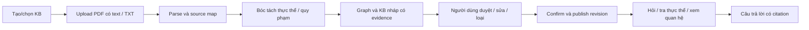

# Demo tuần 02–08/11: upload → thực thể/KB → confirm → hỏi đáp

Cập nhật 03/11/2026. Người dùng xác nhận công việc demo tuần này giao Vũ, ưu tiên free và dùng 9Router đã cấu hình trong `.env`. Đây là kế hoạch thực thi/Jira, chưa phải thông báo các chức năng đã hoàn thành.

## 1. Luồng nghiệm thu

Trước confirm, backend từ chối truy vấn KB. Sau confirm, mỗi request bind `KB ID + published revision + session`; chỉ facts/source/evidence được publication policy cho phép mới vào context. Machine validation accepted không thay cho quyết định duyệt của người dùng.

Confirm là tạo một revision bất biến có manifest, reviewer/time/reason và phạm vi đã duyệt. Không ghi đè raw/draft. Khi sửa/xóa/tạo phiên bản mới, index/cache cũ bị invalidated hoặc giữ riêng theo revision; không âm thầm đổi tri thức giữa các lượt chat.

Hỏi đáp không phải train/fine-tune model theo mỗi tài liệu. Hệ thống dùng retrieval + graph evidence của KB vừa tạo.

## 2. Phạm vi demo khả thi

- 1–2 PDF có text hoặc TXT, tổng tối đa 10 trang và 20.000 source tokens cho lượt demo; 10 MB/file. Đây là giới hạn thiết kế đề xuất, chưa là năng lực đã đo. Preflight phải đếm theo parser/tokenizer thực tế, không suy token chỉ từ trang.
- Một chủ đề pháp luật lao động, tài liệu công khai cho lần thử provider đầu tiên.
- Một người dùng/session, nhưng KB/file/job/revision/index phải có phạm vi và kiểm tra chủ sở hữu để không lẫn giữa các KB. Multi-user production auth/SSO chưa nằm trong demo.
- Xem graph/bảng thực thể và quy phạm, mở quote, duyệt/sửa/loại, confirm, rồi hỏi đáp/tra quan hệ có citation.
- PDF scan/OCR, DOCX, chia sẻ nhóm, chỉnh graph phức tạp, tìm web ngoài KB và suy luận hiệu lực đầy đủ để sau demo. File không hỗ trợ phải báo rõ.
- Demo config tách ĐK1–ĐK4; không nhận các thí nghiệm nghiên cứu đã hoàn thành chỉ vì demo chạy bằng subset.

## 3. Đã có và cần bổ sung

| Tầng | Tái sử dụng | Cần làm để đạt luồng người dùng |
|---|---|---|
| Nguồn/parser | Snapshot VBPL, text parser, Unicode/source map | Nhận file upload, adapter PDF text/TXT, page/paragraph mapping |
| Extraction | Typed norm graph; 8 ứng viên semantic + 4 fallback, tất cả review | Provider thật; bóc tách file mới không hardcode; raw/errors và output alignment |
| Graph/KB | JSON/SQLite, viewer và per-slot evidence | KB/job/revision scope, review decisions, confirm/publication policy |
| Retrieval | BM25 và reference/parent graph | Index/query chỉ published revision, dữ liệu rejected/candidate không thành fact |
| Answer | CachedProvider boundary | Live generator, context budget, citation gate, conversation scope |
| UI | Viewer tự chứa dữ liệu | Upload/progress/review/confirm/chat cùng một luồng |
| Tests | 56 unittest và DOM smoke | E2E file mới, confirmation gate, isolation, quota và restore |

## 4. Phân công và lịch

Vũ phụ trách toàn bộ phần demo tuần này theo xác nhận người dùng. Các task nghiên cứu ngoài nhóm demo không tự chuyển sang Vũ hoặc thay trạng thái.

| Hạn | Đầu ra | Jira chính |
|---|---|---|
| 04/11 | Upload/job + PDF text parser + schema KB/review; adapter/pilot/quota 9Router | SCRUM-13, 14, 15 và W45.UPLOAD |
| 05/11 | Entity/norm extraction và draft graph trên file mới | SCRUM-17 |
| 06/11 | Evidence validation, review/confirm/published revision, scoped retrieval | SCRUM-18, 19 và W45.CONFIRM |
| 07/11 | Luồng UI + hỏi đáp thật có citation trên KB đã confirm | SCRUM-20, 64 và W45.UI |
| 08/11 | E2E, sửa lỗi chặn, restore/runbook và video dự phòng | SCRUM-21, 65 và W45.REGRESSION |

Ngày 02/11 đã qua: ghi nhận là nền local đã chuẩn bị, không lùi ngày bắt đầu giả định. Số giờ Vũ còn lại tuần này chưa được đo; lịch trên có rủi ro nếu provider/pilot hoặc extraction bị chặn. Giữ phạm vi nhỏ thay vì mở thêm chủ đề.

Các mã W45 là tên local của bốn subtask mới dưới SCRUM-21; kết quả đồng bộ sẽ ghi trong `jira-sync-demo-2026-11-03.md`.

## 5. Provider cần dùng

| Thành phần | Phương án demo | Có cần dịch vụ ngoài? |
|---|---|---|
| LLM extraction | Qua 9Router, thử model được xác nhận free rồi chọn theo JSON/quote/qualifier/latency | Có; tái sử dụng router đã host |
| LLM answer | Có thể dùng cùng provider/model để giảm cấu hình; context từ KB đã confirm | Có; cùng router |
| Embedding | P1 sau khi baseline BM25/graph chạy; chọn local hoặc route embeddings riêng đã kiểm tra | Chưa bắt buộc cho demo |
| Parser PDF/TXT | Thư viện local, không gửi raw file vào provider nếu đã trích text được | Không |
| File store, job, review, graph/KB | Filesystem và SQLite trong Lexora | Không |
| OCR, reranker, web search, auth cloud | Ngoài phạm vi demo tuần này | Không cần thêm |

API key chỉ dùng phía server và không đưa vào UI, Jira, prompt hoặc log. Endpoint dùng biến env, không hardcode URL tunnel vào source/task.

## 6. Kiểm tra 9Router hiện có

Đã đọc metadata `.env` có che key; `9ROUTER_URL` và `9ROUTER_KEY` có cấu hình, nhưng MODEL_PROVIDER/GENERATION_MODEL/EMBEDDING_MODEL và MODEL_API_KEY còn trống. Không tự sửa `.env` trong tác vụ lập kế hoạch này.

Đã dùng key đọc catalog `/v1/models` theo phạm vi người dùng cho phép: HTTP 200, 618 entries và thấy ba alias cấu hình:

- `ollama/beam`
- `ollama/nemotron-3-ultra:cloud`
- `ollama/gpt-oss:120b`

Catalog chỉ xác nhận model được công bố, không chứng minh upstream đang có kết nối khỏe, key có thể generate, token còn lại, strict JSON support hay route đang free. Không có inference call hoặc tài liệu được gửi. Numeric quota còn lại vẫn unknown; không đọc admin quota toàn router vì có thể bao gồm kết nối ngoài phạm vi key Lexora.

Lần đọc metadata đầu nhận 403; lần đọc tiếp với User-Agent ứng dụng rõ ràng trả 200. Không đổi URL/key, không bypass auth/TLS, không sửa router. Báo cáo đã lược bỏ URL/key: `docs/report/9router-catalog-check-2026-11-03.json`.

Theo [tài liệu 9Router](https://docs.9router.com/), router cung cấp endpoint tương thích Chat Completions và có route embeddings, quota tracking/fallback. Những khả năng quảng bá không chứng minh mọi upstream/alias của instance hiện tại đều hỗ trợ giống nhau.

Theo [thông báo Ollama về Beam](https://ollama.com/blog/reflection-beam), Beam được mở free trong thời gian giới hạn. Đây là ứng viên thử trước, chưa có ngày hết promotion được xác minh. [Bảng giá Ollama](https://ollama.com/pricing) hiện niêm yết giá theo token cho GPT-OSS 120B và Nemotron 3 Ultra; không tự fallback sang hai route đó khi yêu cầu free-only chưa được xác nhận ở kết nối của người dùng.

[Tài liệu structured outputs của Ollama](https://docs.ollama.com/capabilities/structured-outputs) hiện ghi cloud chưa hỗ trợ structured outputs. Vì vậy extraction qua các route cloud phải được kiểm tra thực tế: prompt JSON + validate local + tối đa một lần repair; không cam kết `response_format/json_schema` được upstream cưỡng chế chỉ vì gateway tương thích API. Chuỗi quote vẫn phải align exact và người dùng review sau đó.

## 7. Quota cần cho demo — dự toán, không phải quota được cấp

Giả định cho một lượt đầy đủ: 20k source tokens chia thành 10 chunk, mỗi chunk 2k source + 1k parent context + 1.5k instruction/schema; tối đa 2k output/chunk. Phần chat gồm 30 câu, mỗi câu 6k input (gồm prompt/history/evidence) + 0.8k output.

| Hạng mục | Calls | Input tokens | Output tokens |
|---|---:|---:|---:|
| Extraction một corpus | 10 | 45.000 | 20.000 |
| 30 câu hỏi | 30 | 180.000 | 24.000 |
| Tổng một lượt | 40 | 225.000 | 44.000 |
| Dự phòng 20% retry/repair | ~48 | 270.000 | 52.800 |

Hai lần diễn tập thêm 60 câu chat, tái sử dụng cache extraction: tổng cả ba lượt khoảng 120 calls, 702k input và 110.4k output sau dự phòng 20%. Đề xuất envelope cho cả tuần/pilot: **1M input + 200k output, tối đa 150 calls**, concurrency 1, khởi đầu limiter 2 RPM. Đây là soft/hard cap ứng dụng đề xuất; không phải quyền tiêu thụ provider đã được xác nhận.

Mục tiêu vận hành cần kiểm tra: khoảng 15k TPM cho 2 request cỡ tối đa 6.5–6.8k total tokens/phút, context ít nhất 8k (ưu tiên 16k), và khoảng 100–150 requests/ngày nếu dồn pilot/diễn tập một ngày. Provider có thể đếm input/output/estimated maximum/reasoning khác nhau; quota phải chốt từ instance/upstream và số đo thực.

Ở 2 RPM, riêng 10 request extraction cần tối thiểu khoảng 5 phút nếu gửi đều, chưa tính latency/retry. Để demo đỡ chờ, dùng file mới nhỏ 2–5 trang trong buổi trình diễn và hiển thị tiến độ job. Cache không được trình bày như lần extraction mới; replay phải có nhãn.

Reasoning tokens, tokenizer tiếng Việt, số claim đầu ra và dữ liệu dài có thể vượt dự toán. Pilot cần ghi usage thực rồi giảm chunk/budget hoặc điều chỉnh envelope; không ẩn token thinking/retry, không tăng phí tự động. Embeddings nếu thêm vào: dự trù riêng khoảng 20–50k tokens/corpus cùng query tokens, không suy ba alias chat hiện có cung cấp embeddings.

## 8. Các gate phải qua

1. Provider preflight: xác nhận route/key/free status, quota/reset, context/output limits và JSON behavior; chưa đạt thì ghi blocker, không gọi paid.
2. Upload preflight: MIME/size/page/token limit, file an toàn, KB owner scope và parser đọc được.
3. Integrity gate: quote/ID/hash/offset; schema đúng chưa đồng nghĩa pháp lý đúng.
4. Human gate: xem/sửa/loại và confirm published revision; không bypass bằng machine accepted.
5. Answer gate: KB/revision/session scope, citation trong bundle, status thiếu căn cứ/quota/service lỗi rõ ràng.

Việc đọc catalog/quota đã được duyệt; thử inference hoặc gửi tài liệu lên provider là bước riêng, chưa thực hiện trong tác vụ cập nhật Jira này. Chỉ chạy pilot sau khi phạm vi gọi model/dữ liệu được người dùng duyệt.

## 9. Đồng bộ Jira

Payload cụ thể và bản trước khi sửa được lưu local ở `jira-backlog-demo-2026-11-03.json`. Kế hoạch gồm 32 issue updates (8 task cha, 24 subtask) và 4 subtask mới; không đổi status, không xóa issue hoặc thay sprint/native issue links. Các phụ thuộc vận hành mới được ghi trong mô tả; quan hệ nghiên cứu cũ chưa tự xóa.

Toàn bộ nhóm demo được giao Vũ; task nghiên cứu khác vẫn giữ phân công cũ. Các artifact local chưa push không được mô tả như code đã có trên GitHub. Lỗi/timeout khi ghi Jira phải đọc lại trước khi retry để tránh báo thành công sai hoặc tạo issue trùng.
