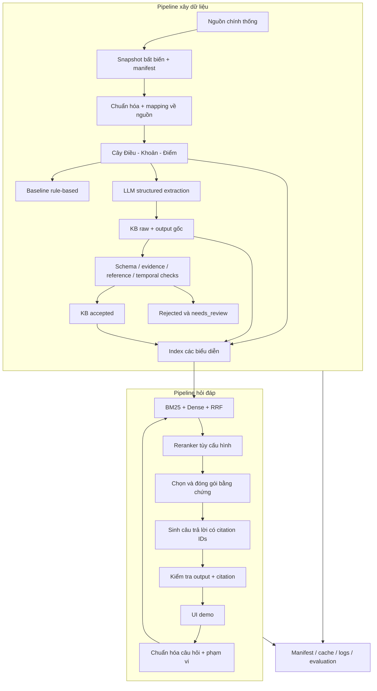
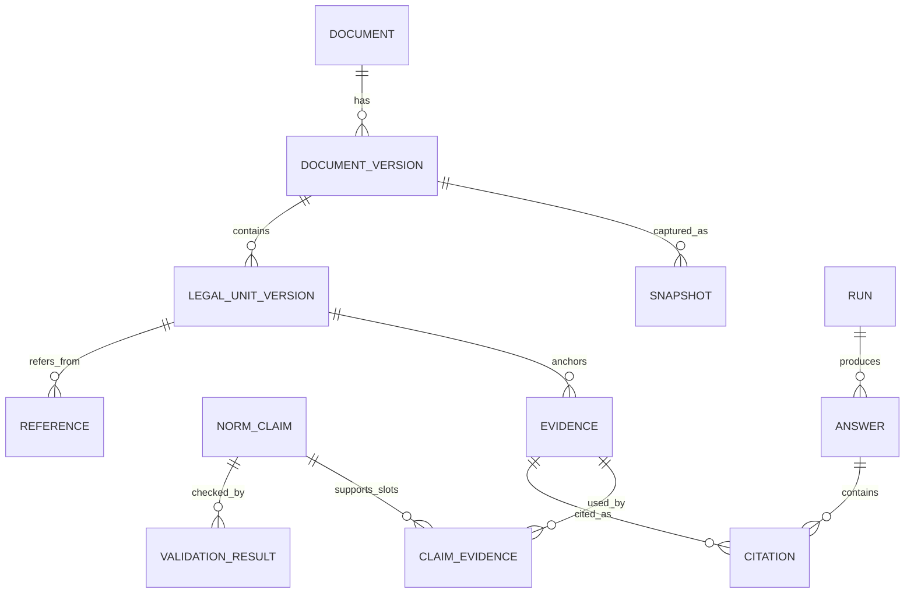
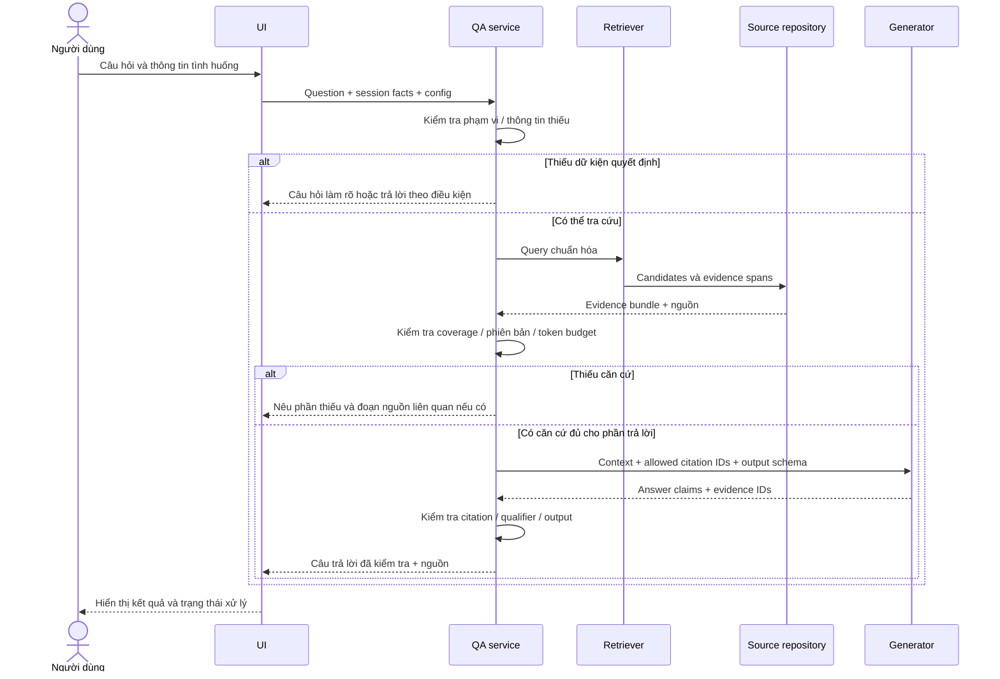
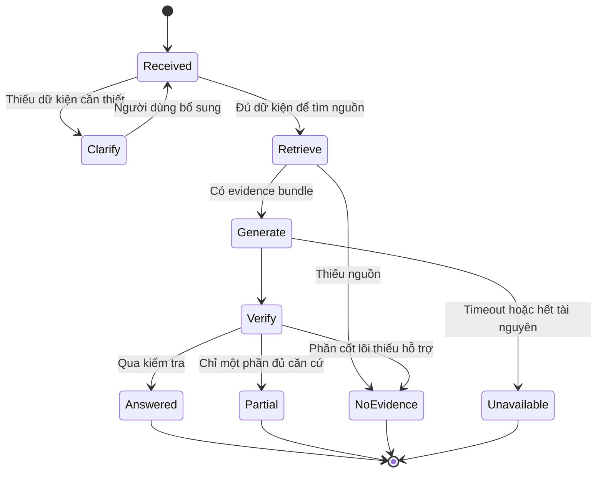
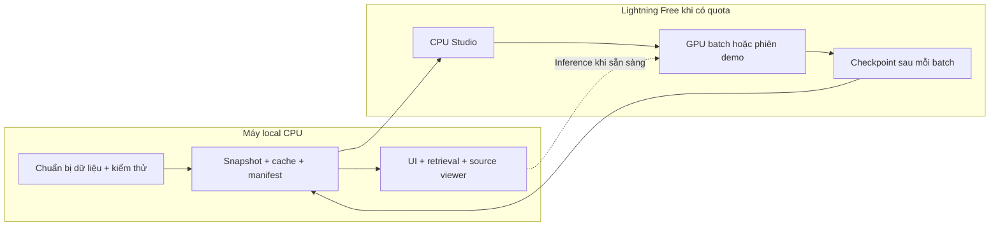
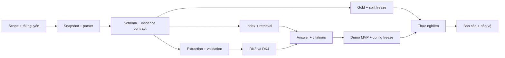

# Lexora — Kế hoạch kiến trúc và kỹ thuật chi tiết

Ngày: 01/11/2026. Trạng thái: thiết kế đề xuất để triển khai, chưa phải mô tả hệ thống đã chạy. Các con số top-k, token, batch, latency trong tài liệu là điểm khởi đầu hoặc mục tiêu pilot, chưa phải kết quả đo.

## 1. Mục tiêu, ràng buộc và quyết định chính

Theo xác nhận ngày 01/11: giữ hai thành viên Kha/Vũ và hạn 20/12/2026; dùng Lightning AI mức miễn phí; ưu tiên chất lượng demo; có thể mở rộng phạm vi khi phù hợp. Chưa biết quota GPU thực tế và số giờ làm mỗi tuần. Không giả định GPU sẵn sàng liên tục.

Tài liệu này chi tiết hóa [kế hoạch tiến độ](implementation-plan.md), [kiến trúc MVP](../architecture.md), [hợp đồng dữ liệu](../data-contracts.md), [giao thức thực nghiệm](../evaluation-protocol.md). Các mở rộng schema dưới đây là đề xuất v1 cần triển khai migration, chưa tự động thay đổi schema/config hiện có.

**Hướng chọn:** RAG pháp luật có nhận biết cấu trúc, lưu bằng chứng đến từng phát biểu, kết hợp truy xuất từ khóa và ngữ nghĩa, kiểm chứng dữ liệu theo nhiều lớp, trả lời có điều kiện áp dụng và khả năng hỏi lại. LLM hỗ trợ trích xuất và diễn đạt; văn bản nguồn cùng mapping bằng chứng là nền tảng kiểm tra.

### 1.1. Kết quả demo cần đạt

1. Người dùng hỏi bằng tiếng Việt tự nhiên, có thể dùng cách nói đời thường.
2. Hệ thống xác định chủ đề, thông tin còn thiếu, phạm vi thời gian, rồi truy xuất nguồn.
3. Trả lời ngắn trước, giải thích điều kiện/ngoại lệ sau; từng nhận định pháp lý quan trọng có dẫn nguồn.
4. Bấm citation để thấy đúng đoạn trích, tên văn bản, Điều/Khoản/Điểm, phiên bản snapshot và liên kết gốc.
5. Nếu thiếu căn cứ, nói rõ phần thiếu; nếu thiếu thông tin tình huống, hỏi tối đa 1–2 câu cần thiết.
6. Có ba chế độ vận hành được ghi rõ: trả lời trực tiếp bằng model; tra cứu/trích dẫn khi model không sẵn sàng; phát lại kết quả đã lưu cho các ví dụ cố định.
7. Có màn hình chẩn đoán dành cho nhóm: retrieval, context, thời gian từng bước và kết quả validation.

### 1.2. Phạm vi nội dung

MVP tập trung 3–4 nhóm: hợp đồng/thử việc; tiền lương và thời giờ làm việc; nghỉ phép; chấm dứt hợp đồng. Đây là danh mục đề xuất để chọn corpus, chưa xác nhận nội dung pháp lý cụ thể.

Mục tiêu gốc 8–12 văn bản và 60–100 điều khoản vẫn dùng để ước lượng. Phải định nghĩa “điều khoản” trong manifest: báo cáo riêng số Điều, Khoản, Điểm, số đơn vị lá được index và số claim. Không cộng cha và con rồi coi đó là số quy phạm độc lập.

Mở rộng theo **gói chủ đề** thay vì tăng văn bản tùy ý. Một gói chỉ được đưa vào demo khi có nguồn được kiểm tra, parser đạt kiểm tra thủ công, bộ câu dev, căn cứ về phạm vi thời gian, và câu ngoài phạm vi tương ứng. Giới hạn gói mới trước freeze; không thêm chủ đề trong thời gian thực nghiệm chính thức.

## 2. Các phương pháp hiện đại và cách áp dụng

Nguồn kỹ thuật được đối chiếu ngày 01/11/2026. “Mới” là ứng viên để đánh giá; chất lượng tiếng Việt pháp luật phải đo tại Lexora, không suy từ bảng xếp hạng tổng quát.

| Phương pháp | Cách áp dụng cho Lexora | Ưu tiên và điều kiện |
|---|---|---|
| Structured output / constrained decoding | LLM sinh JSON theo schema; lưu raw; kiểm tra nội dung riêng | P0, giảm lỗi định dạng. vLLM có cơ chế structured output; cấu trúc đúng không bảo đảm ngữ nghĩa đúng [S1] |
| Structure-aware retrieval | Chia theo Điều/Khoản/Điểm, giữ câu dẫn và provenance | P0, phù hợp nguồn có cấu trúc |
| Hybrid sparse+dense | BM25 + embedding đa ngôn ngữ, hợp nhất thứ hạng RRF | P0 cho demo; dùng cùng cách truy xuất khi so bốn điều kiện |
| Contextual retrieval | Thêm tên văn bản/đường dẫn cấu trúc vào bản dùng để index; thử context do LLM sinh sau | Metadata xác định trước ở MVP; context sinh bằng LLM là ablation. Cách contextual retrieval gốc bổ sung ngữ cảnh trước embedding/BM25 [S2] |
| Reranking | Qwen3-Reranker-0.6B sắp lại nhóm ứng viên nhỏ | P1 ưu tiên cho demo nếu pilot có lợi và tài nguyên đủ [S3] |
| Evidence-first generation | Chọn bằng chứng trước, tạo phát biểu có evidence IDs, kiểm tra rồi hiển thị | P0; là thiết kế tổng hợp cho Lexora, không tuyên bố thuật toán mới |
| Bounded reference expansion | Mở thêm câu dẫn/định nghĩa/dẫn chiếu tường minh tối đa một bước | P1 demo, thí nghiệm phụ riêng |
| Late chunking | Encode với ngữ cảnh lớn rồi pooling theo span nhỏ | P2. Cần token embeddings và pooling tương thích; không thay pooling model tùy ý [S4] |
| Contextual embeddings mới | Thử pplx-embed-v2-context nếu có thời gian | Theo dõi. Bài 28/10/2026 nhấn mạnh cả đoạn trả lời và bằng chứng kiểm tra; chưa kiểm chứng trên Lexora [S5] |
| GraphRAG / LightRAG | Tham khảo mô hình quan hệ và cách mở rộng ngữ cảnh | P2. GraphRAG global search dùng community reports, khác nhu cầu trích dẫn chính xác của MVP; LightRAG kết hợp đồ thị và vector [S6][S7] |

Không cần fine-tune LLM trong MVP. Với gold vài chục điều khoản, ưu tiên sửa corpus/parser/evidence trước. Nếu nghiên cứu thêm LoRA hoặc embedding fine-tuning, cần tập train độc lập, tài nguyên và baseline; không dùng 45 câu held-out để tạo dữ liệu huấn luyện.

## 3. Kiến trúc tổng thể

Một codebase Python theo module. Batch ingestion/extraction/indexing chạy offline; hỏi đáp chạy online từ artifact đã đóng phiên bản. UI gọi service nội bộ, chưa cần tách nhiều server.



### 3.1. Stack đề xuất

| Lớp | Lựa chọn | Lý do và giới hạn |
|---|---|---|
| Ngôn ngữ | Python 3.11 hoặc 3.12 sau kiểm tra backend | Một runtime cho batch, model, evaluation; khóa phiên bản sau pilot |
| Schema | Pydantic v2 + JSON Schema | Validate API và file; enum rõ; cấm trường dư khi phù hợp |
| CLI | Typer | Lệnh nhỏ chạy lại từng stage; notebook chỉ dành khám phá |
| Dữ liệu chuẩn | JSONL + manifest JSON | Dễ diff, kiểm tra, chuyển giữa hai thành viên |
| Kho đọc demo | SQLite | Metadata, relations, sessions; build lại từ JSONL; không coi DB là bản gốc duy nhất |
| Dense search | NumPy exact dot product trên vector chuẩn hóa | Corpus nhỏ: dễ xác minh, không có sai số ANN; chuyển FAISS khi cần đo scale |
| Lexical search | BM25 qua thư viện Python mỏng | Tokenizer/version rõ, cùng preprocessing query/document |
| Model adapter | Transformers hoặc endpoint inference được cấu hình | Khóa model/revision; không đưa logic prompt vào UI |
| UI | Streamlit, gọi Python service trực tiếp | Nhanh làm nguồn/citation/debug; FastAPI chỉ thêm khi cần client độc lập |
| Tests | pytest | Fixture tổng hợp, offline; integration model chạy tách |
| Môi trường | uv hoặc pip lock sau pilot | Chỉ ghi lệnh cài/run đã kiểm tra khi code tồn tại |
| Vận hành | Máy local CPU + Lightning GPU theo batch | Artifacts/cache tồn tại độc lập vòng đời GPU |

Các thư viện trên là lựa chọn thiết kế; chưa cài đặt hay xác nhận tương thích trong workspace. Kiểm tra license và khóa dependency trước 27/11. Docling là adapter tùy chọn cho PDF phức tạp; tài liệu hiện có nhiều OCR engine, cần kiểm tra ngôn ngữ và chi phí xử lý [S8].

### 3.2. Trách nhiệm module

| Module hiện có | Input → output cần xây | Người chính |
|---|---|---|
| ingestion | URL/file → snapshot + manifest | Vũ; Kha kiểm tra nguồn |
| normalization | snapshot → text chuẩn + source map | Vũ |
| schemas | schema v1 + load/validate/migrate | Kha; Vũ review |
| extraction | LegalUnit → rules/LLM claims + raw response | Kha |
| validation | raw claims → decisions + accepted snapshot | Kha |
| kb | JSONL → SQLite/read repository | Kha |
| indexing | representation → BM25/vector index + mapping | Vũ |
| retrieval | query + config → ranked candidates + trace | Vũ |
| rag | query → context → answer → checked response | Vũ |
| providers | generate/embed/rerank interfaces + resource errors | Vũ; Kha dùng chung |
| evaluation | frozen input + runs → metrics/error tables | Cả hai |
| common | hash, config, provenance, retry, logging | Cả hai, một contract |
| apps/demo | hỏi đáp, nguồn, trạng thái, debug | Vũ; Kha test nội dung |

## 4. Dữ liệu và corpus

### 4.1. Thu thập có kiểm soát

Mỗi tài liệu phải có: mã văn bản, tên, cơ quan ban hành nếu xác định, URL gốc, URL/file tải thực tế, thời gian tải UTC, MIME type, SHA-256 bytes, phạm vi chủ đề, lý do đưa vào corpus và người kiểm tra. Nguồn web có thể thay đổi, nên một URL không thay cho snapshot.

Ưu tiên lấy HTML có cấu trúc hoặc PDF có text từ nguồn chính thống. Nguồn tổng hợp chỉ phục vụ tìm kiếm ban đầu, không tự trở thành nguồn chuẩn. Tình trạng hiệu lực phải gắn nguồn riêng nếu nguồn chính không nêu rõ; chưa xác minh thì unknown. Tài liệu này không liệt kê văn bản cụ thể là “đang có hiệu lực” khi chưa kiểm tra.

Lưu nguyên file và nội dung phản hồi cần thiết; kiểm tra không tải nhầm trang lỗi/login. Retry hữu hạn, cache theo hash, không ghi đè bản cũ. Một văn bản có nhiều snapshot và nhiều phiên bản nội dung; hai file khác hash chưa chắc là hai phiên bản pháp lý khác nhau.

### 4.2. Chuẩn hóa và source map

1. Decode theo encoding nguồn; ghi lỗi thay thế ký tự.
2. Chuẩn Unicode NFC; chuẩn newline. Giữ nguyên chữ số, dấu phủ định, liên từ, ký hiệu và thứ tự.
3. Gỡ header/footer chỉ khi có quy tắc lặp và audit; không xóa dòng chỉ vì giống số trang.
4. Chuẩn khoảng trắng theo chính sách khóa; giữ bản trước chuẩn hóa để kiểm tra.
5. Với mỗi đoạn text chuẩn, lưu nguồn tương ứng: trang/bounding box hoặc DOM path và offsets gốc. Mapping nhiều-một sau NFC phải được lưu bằng segment mapping, không cộng một offset cố định.
6. Hash text chuẩn cùng normalization version. Thay normalization tạo artifact mới và tính lại evidence/index.

Offset canonical là **Unicode code point trong Python**, khoảng `[start,end)`. JavaScript dùng UTF-16; UI phải đổi offset hoặc nhận sẵn các đoạn trước/highlight/sau từ backend. Test có dấu tiếng Việt tổ hợp và ký tự ngoài BMP.

### 4.3. Parser cấu trúc: state machine + stack

Nhận diện nhãn ở đầu dòng/block: Chương, Mục, Điều, khoản số, điểm chữ. Regex chỉ đề xuất boundary; state machine xét vị trí hiện tại, thứ tự nhãn, font/block nếu có, tránh nhận câu “theo Điều ...” trong thân văn bản là heading.

```text
for block in normalized_blocks:
    candidate = detect_heading(block, current_state)
    if candidate is credible:
        close units at same/deeper structural level
        attach new unit to nearest valid parent
        retain heading span and body spans
    else:
        append block to current unit
audit orphan units, sequence gaps, duplicates and unassigned text
```

Mỗi unit có `own_text` và mapping về văn bản; `full_text` gồm con nếu cần được dựng từ spans. Index theo một chính sách chọn đơn vị lá; không index cả article toàn văn và từng clause trùng nhau mà không có dedup. Câu dẫn ở cha là dependency, giữ riêng để không mất điều kiện chung.

Parser không tự sửa khoản “1” OCR thành “l” nếu chưa có căn cứ; đánh dấu review. PDF scan/OCR nên tránh trong pilot khi có bản HTML/text tương đương. Nếu buộc dùng OCR, kiểm tra thủ công các số, từ “không”, ngày tháng, dấu % và nhãn Điều/Khoản; output OCR không đồng nghĩa nguồn đáng tin.

### 4.4. Định danh và versioning

Tách `document_id` ổn định theo văn bản, `document_version_id` theo nội dung phiên bản, `snapshot_id` theo bytes và `unit_version_id` theo version + structural path + normalized text hash. `unit_id` là định danh logic; mọi evidence phải neo vào `unit_version_id` cụ thể.

Đổi nội dung tạo version mới; không tái sử dụng offset. Nếu nguồn không đủ để xác lập văn bản pháp lý cùng loại/khác loại, giữ candidate mapping và review, không gộp chỉ vì cùng tiêu đề.

## 5. Mô hình tri thức: quy phạm có điều kiện và bằng chứng

### 5.1. Vì sao cần hơn triple

Một quan hệ “người lao động — được hưởng — quyền X” dễ bỏ mất đối tượng đủ điều kiện, giới hạn, ngoại lệ, thời hạn và dẫn chiếu. Biểu diễn chính là **NormClaim**; triple/graph là view phục vụ tra cứu.

Các trường đề xuất:

| Nhóm | Trường | Nguyên tắc |
|---|---|---|
| Định danh | claim_id, schema_version, source_unit_version_ids | ID do chương trình tạo, không tin ID LLM tự bịa |
| Chủ thể | actor, beneficiary, counterparty | Mỗi slot có text và evidence IDs; không ép mọi slot phải có |
| Tính quy phạm | modality | obligation / permission / prohibition / entitlement / definition / procedure / unknown |
| Nội dung | action, object, outcome | Giữ từ ngữ gốc; phần diễn đạt chuẩn hóa có trường riêng |
| Phạm vi | conditions, exceptions, scope | Mảng span, nối AND/OR chỉ khi nguồn xác định |
| Định lượng | quantities, deadlines | value, comparator, unit, basis, trigger; không chỉ lưu số |
| Dẫn chiếu | references | raw mention, target candidates, resolution status, required_for_interpretation |
| Thời gian | effective metadata + provenance | Phân biệt thời gian văn bản, quy phạm và thời gian tình huống |
| Bằng chứng | evidence_ids, slot_evidence | Chỉ rõ nguồn của từng slot và qualifier |
| Trích xuất | extraction_run_id, model_revision, prompt_hash | Truy được về request/response gốc |
| Kiểm chứng | validation_decision, reason_codes | Snapshot riêng; không sửa âm thầm raw |

`null`, `not_present`, `unknown` phải phân biệt. `exceptions=[]` chỉ nghĩa chưa trích được ngoại lệ trong phạm vi đã xét, không khẳng định toàn bộ pháp luật không có ngoại lệ. Thêm `extraction_scope` và `completeness=unknown/explicitly_complete` khi phù hợp.

### 5.2. Quan hệ và entity resolution

Quan hệ cấu trúc: `PART_OF`, `REFERENCES`, `DEFINES`. Quan hệ pháp lý: `AMENDS`, `REPLACES`, `EXCEPTION_TO`, `APPLIES_UNDER` chỉ tạo khi có bằng chứng trực tiếp. Không suy luật ưu tiên giữa các văn bản chỉ bằng ngày ban hành hay thứ bậc.

Entity ID ban đầu scope theo văn bản/unit; đồng nhất từ viết tắt bằng alias dictionary có provenance. Tương đồng embedding chỉ gợi ý duplicate, không tự gộp hai chủ thể pháp lý. “Người lao động” và “người lao động thuộc nhóm ...” có thể là concept chung + scope, không xóa scope khi gộp.

### 5.3. Ví dụ fixture tổng hợp

Đoạn giả định, **không phải quy định pháp luật thật**: “Trong trường hợp A, chủ thể B phải thực hiện C trong 7 ngày, trừ trường hợp D.”

Claim lưu actor=B, modality=obligation, action=C, conditions=[A], deadline.value=7, deadline.unit=day, deadline.basis=unspecified, exceptions=[D]. Không đổi “ngày” thành “ngày làm việc”. Mỗi slot trỏ span tương ứng. Nếu nguồn không nói mốc bắt đầu 7 ngày, deadline.trigger=unknown.



## 6. Extraction: rule baseline và LLM

### 6.1. Baseline rule-based

Regex cho số/ngày/thời hạn/dẫn chiếu; lexicon cho chủ thể và modality; khoảng câu/clause cho evidence. Quan hệ chỉ tạo bằng pattern được ghi rõ, ví dụ actor gần động từ quy phạm trong cùng clause. Ambiguous thì unknown. Baseline dùng cùng schema và matching metrics với LLM để trả lời RQ1; không thay nhánh ĐK3 bằng rule baseline.

### 6.2. LLM extraction hai bước có giới hạn

**Bước A:** input gồm target unit, câu dẫn cha, definitions/dẫn chiếu đã biết khi cấu hình cho phép; mọi nguồn mang ID. Prompt yêu cầu tìm claim và quote nguyên văn, giữ phủ định, AND/OR, ngoại lệ, không hoàn thiện nội dung bằng kiến thức nền.

**Bước B:** chương trình align quote về text chuẩn, cấp evidence IDs, kiểm tra slot và schema. LLM trả quote + unit ID tốt hơn tự đếm offset. Nếu quote xuất hiện nhiều lần, dùng context trước/sau hoặc occurrence do model chỉ ra; còn mơ hồ thì review. Exact match ưu tiên; fuzzy match chỉ là đề xuất sửa, không thành evidence accepted tự động.

Constrained decoding theo JSON Schema khi backend hỗ trợ [S1]. Nếu không có: parse JSON nghiêm ngặt, tối đa một lần repair định dạng, ghi response gốc và response repair; hết số lần thì extraction_error. Không retry đến khi model trả nội dung mong muốn.

Không đưa guideline hoặc example từ held-out vào prompt. Một unit quá dài được chia ở ranh giới câu/điểm với parent context; lưu subwindow mapping và dedup sau extraction. Không cắt giữa câu khiến mất phủ định/ngoại lệ.

### 6.3. Prompt contract

Input: schema version, target units, allowed IDs, task instruction, vài ví dụ pilot được phép dùng. Output: claims, slot quotes, unresolved references, uncertainty reasons. Không yêu cầu model cung cấp phần suy nghĩ nội bộ; chỉ cần kết quả có cấu trúc và căn cứ ngắn.

Cache key = hash(stage + input artifact hashes + model ID/revision + tokenizer/template + prompt + decoding + schema + code version). Phân biệt raw provider response, parsed candidates và validated output. Có thay đổi repair policy cũng đổi hash.

## 7. Validation nhiều lớp

### 7.1. Luật kiểm tra

| Lớp | Kiểm tra | Kết quả điển hình |
|---|---|---|
| V0 transport | JSON parse, response đầy đủ, không bị truncate | error không âm thầm thành zero claims |
| V1 schema | type/enum/required fields, quantity format | sai cứng → rejected |
| V2 integrity | unit/entity ID tồn tại, đúng version, không cycle parent | sai cứng → rejected |
| V3 evidence | bounds, hash, exact quote, provenance | sai cứng → rejected |
| V4 slot grounding | mỗi slot quan trọng có evidence; số/đơn vị/phủ định khớp pattern | mismatch chắc chắn → rejected; khó quyết định → needs_review |
| V5 reference | định danh đích và phạm vi tham chiếu | external/pending ghi rõ; bắt buộc cho nghĩa mà thiếu → needs_review |
| V6 temporal | ngày parse được; khoảng thời gian nhất quán; có nguồn cho trạng thái | dữ liệu mâu thuẫn → review/reject theo reason cụ thể |
| V7 duplicates | cùng nội dung, qualifier, version và evidence | giữ raw; representative deterministically, log duplicate IDs |
| V8 semantic | điều kiện/ngoại lệ bị thiếu; suy diễn vượt nguồn | đánh giá người trên gold; model verifier chỉ supplementary |

**Accepted nghĩa là qua các kiểm tra đã triển khai**, không đồng nghĩa quy phạm chắc chắn đúng về ngữ nghĩa hoặc áp dụng được cho mọi tình huống. Vì vậy phải đo lỗi còn sót. Một quote tồn tại vẫn có thể bị diễn giải ngược nghĩa.

### 7.2. Quyết định và tránh loại quá mức

Rejected nếu có hard violation; needs_review nếu chưa đủ khả năng quyết định; accepted nếu không có hard violation và không còn ambiguity bắt buộc. Unknown ngày hiệu lực không tự loại một claim mô tả nội dung, nhưng ngăn kết luận “hiện hành” nếu câu hỏi cần điều đó.

Một reference ngoài corpus mang tính bổ sung không nên làm mất toàn bộ claim độc lập. Nếu ý nghĩa phụ thuộc hoàn toàn reference đó, claim phải needs_review. Chính sách này khóa bằng test fixture, không quyết định tùy từng run.

### 7.3. Kiểm chứng validator

Tạo bộ lỗi chèn từ dữ liệu sạch đã đối soát: sai offset, quote không tồn tại, unit sai, hash cũ, enum lạ, đổi số/đơn vị, bỏ phủ định, mất ngoại lệ, ref bịa, khoảng ngày đảo. Giữ cả mẫu sạch để đo false reject. Một số lỗi ngữ nghĩa dự kiến validator deterministic không bắt được; báo cáo limitation thay vì chỉ chọn lỗi dễ.

Đo precision/recall phát hiện lỗi theo loại, false rejection trên mẫu sạch, tỷ lệ retained claims và retained relevant units. Lưu `pass/fail/not_applicable/unknown` từng check để phân biệt chưa kiểm tra với đã pass.

## 8. Index và retrieval

### 8.1. Tách hồ sơ demo và thực nghiệm

| Hồ sơ | Biểu diễn | Mục đích |
|---|---|---|
| DK1 | Fixed chunks từ văn bản chuẩn | Baseline chia cố định |
| DK2 | Structural units | Tác động của cấu trúc |
| DK3 | LLM claims raw, dạng serialize xác định | KB trước validation |
| DK4 | Chính claims DK3 còn accepted | Tác động validation |
| DEMO | Accepted claims + structural text, reranker/expansion nếu đạt pilot | Trải nghiệm tốt nhất trong tài nguyên |

DEMO là cấu hình riêng, không gọi là DK4. Nếu DK4 thiếu claim, không âm thầm bù toàn bộ structural index vào ĐK4. Demo được phép fallback sang structural evidence qua kiểm tra nguồn, đồng thời ghi `retrieval_route=structural_fallback`.

Raw DK3 nghĩa là chưa qua semantic/evidence/ref validation ở tầng KB. Những response không parse được vẫn phải ghi lỗi; index chỉ nhận record có envelope đọc được. Common loader chỉ kiểm tra điều kiện kỹ thuật tối thiểu, không lọc semantic ngầm. Bộ kiểm tra citation ở đầu ra áp dụng chung cho mọi điều kiện; ghi số candidate/citation bị chặn để thấy tác động của raw KB.

DK3 và DK4 dùng cùng renderer, model, query logic và policy; khác tập record qua validation. Nếu dedup là một phần validator thì báo cáo rõ đây cũng là thành phần tác động, không quy toàn bộ chênh lệch cho kiểm chứng evidence.

### 8.2. Chunking và embedding text

DK1 bắt đầu thử 384 token, overlap 64 theo tokenizer đã khóa; thử 256/512 trên dev nếu cần. Dừng ở biên văn bản, mapping tất cả span về canonical units. DK2 ưu tiên khoản/điểm trọn vẹn; unit quá dài chia theo câu với path và câu dẫn cha. Không dùng số ký tự giả làm số token.

Embedding text của structural index gồm tên văn bản + đường dẫn Điều/Khoản/Điểm + nội dung. Claim index gồm actor/modality/action/conditions/exceptions/quantities, thứ tự cố định, và metadata nguồn xác định. Chuỗi serialize là chỉ dẫn tìm kiếm; bản gốc và evidence vẫn được lưu riêng.

Trong bốn điều kiện, metadata thêm vào phải được định nghĩa nhất quán. Không bổ sung synopsis do LLM sinh chỉ cho DK4 rồi gọi đó là thí nghiệm validation. Context do LLM tạo chỉ ở experiment phụ và không được dùng làm bằng chứng pháp luật.

### 8.3. Tokenization tiếng Việt và lexical search

Giữ dấu, lowercase bản index, chuẩn các dạng Điều/khoản/điểm và ký hiệu văn bản bằng quy tắc xác định. Bắt đầu tokenizer Unicode theo từ/âm tiết, giữ mã văn bản và con số như token đặc biệt. Kiểm tra word segmentation và character n-gram ở ablation nếu lỗi từ ghép/không dấu đáng kể. Không xóa “không”, “trừ”, “chỉ”, “và”, “hoặc” bằng stopword list đại trà.

Alias query như “nghỉ việc” có thể gợi ý thuật ngữ chuẩn nhưng luôn giữ truy vấn gốc. Alias dictionary được đóng phiên bản, không xây từ đáp án held-out. Khi câu hỏi ghi đúng Điều và mã văn bản, deterministic lookup là một candidate channel; không bỏ retrieval ngữ nghĩa vì có thể người hỏi dẫn nhầm.

BM25 cho query q và record d:

```text
BM25(q,d) = sum over t in q:
  IDF(t) * tf(t,d)*(k1+1) /
  (tf(t,d) + k1*(1-b+b*len(d)/avgdl))

Khởi đầu pilot: k1=1.2, b=0.75.
```

Ghi implementation IDF, tokenizer và corpus statistics. Không trộn trực tiếp điểm BM25 với cosine vì thang đo khác nhau.

### 8.4. Dense + RRF

Vector `e(x)` được L2-normalize. Dense score `s(q,d)=e(q) dot e(d)`. Với N nhỏ dùng exact search, O(N*d); vector matrix float32 cần xấp xỉ `4*N*d` bytes, chưa tính model/metadata.

Mỗi kênh lấy tối đa 20–30 ứng viên; corpus nhỏ lấy min(N,K). Hợp nhất theo record ID:

```text
RRF(d) = sum over retrieval lists r containing d: w_r / (c + rank_r(d))
Khởi đầu: c=60; sparse/dense có trọng số bằng nhau; rank bắt đầu từ 1.
```

Tie-break theo stable ID để tái lập. Các tham số này là heuristic ban đầu; chọn trên dev rồi khóa. Log riêng lexical rank, dense rank, fused rank; không xem RRF/cosine là xác suất câu trả lời đúng.

### 8.5. Reranking và chọn bằng chứng

Rerank top 20 hoặc ít hơn bằng Qwen3-Reranker-0.6B, theo đúng template/scoring của model card [S3]. Không coi model này là sequence classifier bất kỳ. Đo latency, RAM/VRAM và Recall/nDCG dev trước khi bật mặc định demo.

Gom trùng các record cùng evidence span và cùng nội dung; giữ qualifiers khác nhau. Đầu tiên chọn top 5 đơn vị canonical khác nhau, sau đó đóng gói theo token budget. Báo cáo cả candidate Recall@K trước packing và evidence recall sau packing; retrieval tốt mà bị cắt context vẫn là lỗi hệ thống.

Với câu tổng hợp, một đơn vị không đủ: bộ context phải có coverage cho từng phần hỏi. Dùng decomposition tối đa 2 subqueries ở demo nếu dev chứng minh cần; giữ nguyên query gốc và hợp nhất evidence. Không bật decomposition riêng cho DK4 trong thí nghiệm chính.

### 8.6. Mở rộng dẫn chiếu có giới hạn

Sau seed retrieval, lấy câu dẫn cha và tối đa một bước `REFERENCES/DEFINES/EXCEPTION_TO` đã resolve. Mỗi cạnh có provenance; giới hạn tổng 3 đơn vị bổ sung ban đầu và tổng token budget. Log `seed_id`, `edge_type`, `depth`, lý do thêm. Dừng khi trùng ID, ngoài corpus hoặc hết budget.

Không suy ra A áp dụng cho C chỉ vì A dẫn B và B đề cập C. Graph traversal chỉ bổ sung nguồn đọc. Các unit bổ sung được tính vào context recall/cost; không báo cáo chúng như đã nằm trong top-k retriever.

## 9. Quy trình hỏi đáp, làm rõ và dẫn nguồn



### 9.1. Question understanding

Trích chủ đề, hành động muốn biết, thực thể, ngày/thời điểm, mã văn bản và dữ kiện người dùng cung cấp. Rule-based cho ngày/ID; LLM classification nhẹ chỉ nếu pilot cần. Các giá trị model suy đoán không thành user facts.

Conversation state tách `user_provided_facts`, `clarifications`, `previous_answer_ids`; câu trả lời trước không phải bằng chứng. Rewrite câu hỏi như “còn trường hợp đó thì sao” chỉ dùng facts đã xác nhận, giữ original query và rewrite để audit.

Thiếu dữ kiện chỉ hỏi lại khi nó thay đổi kết luận; không hỏi tràn lan cho câu tra cứu quy định chung. Câu hỏi “hiện nay” cần nguồn xác nhận trạng thái/phiên bản tương ứng. Nếu thiếu, giới hạn rõ trả lời theo snapshot; không dùng ngày hệ thống thay cho bằng chứng hiệu lực.

### 9.2. Context builder

Mỗi evidence block có ID cục bộ như E01, canonical unit version, tên văn bản, path, exact quote, source link và tình trạng metadata. ID citation do backend cấp. Model không được tạo URL hoặc Điều/Khoản mới.

Budget khởi đầu: 3.000–5.000 token evidence, output tối đa 600–900 token; giá trị thật phụ thuộc model/runtime. Luôn tính system prompt, history, schema, evidence và output reserve trong giới hạn context. Không cắt giữa quy phạm và ngoại lệ; thiếu chỗ thì giảm đơn vị ít liên quan hoặc yêu cầu thu hẹp câu hỏi.

Ưu tiên nguyên văn evidence và qualifier; metadata ngắn. Nén trích xuất bằng chọn câu có mapping được phép sau pilot; tóm tắt LLM không thay thế nguyên văn nguồn. Relevance của cùng unit không đồng nghĩa mọi câu trong unit hỗ trợ câu trả lời.

### 9.3. Answer contract v1 đề xuất

```json
{
  "status": "answered",
  "summary": "Kết luận ngắn được tạo từ các phát biểu đã kiểm tra",
  "claims": [
    {
      "claim_text": "Nội dung trả lời",
      "evidence_ids": ["E01"],
      "conditions": [],
      "support_status": "machine_checked"
    }
  ],
  "missing_facts": [],
  "limitations": [],
  "source_snapshot_id": "snapshot-id",
  "run_id": "run-id"
}
```

Các status: answered, partial, clarification_needed, insufficient_evidence, out_of_scope, service_unavailable. Adapter tương thích trường `abstained/reason` hiện tại; định nghĩa mapping để đánh giá không nhầm partial với refusal.

Summary cũng phải được kiểm tra hỗ trợ hoặc render từ checked claims; không để model thêm kết luận ngoài các claims đã kiểm tra. Phần hướng dẫn thao tác chung phải phân biệt với nhận định pháp lý.

### 9.4. Output verification và abstention

Deterministic gate: JSON hợp lệ; citations thuộc bundle; unit/hash/offset đúng; claim quan trọng có citation; số/đơn vị trong claim phù hợp evidence khi check được; không tự khẳng định “đang có hiệu lực” từ unknown metadata.

Gate ngữ nghĩa: rubric kiểm tra evidence có hỗ trợ phát biểu, có mất phủ định/ngoại lệ không. Có thể thử model verifier ở demo, nhưng false positive và latency phải được đo. Đây không phải bằng chứng tự thân về tính đúng pháp lý.

Chính sách demo: lỗi định dạng có tối đa một repair; claim thiếu hỗ trợ có thể loại và trả partial với phần thiếu rõ; nếu mất phần cốt lõi thì insufficient_evidence. Thực nghiệm khóa cùng chính sách mọi nhánh và lưu trước/sau gate. Model self-confidence không dùng làm ngưỡng tin cậy. Ngưỡng retrieval nếu dùng phải tune trên dev với trade-off coverage/risk.



## 10. Chọn model và vận hành trong Lightning Free

### 10.1. Danh sách pilot nhỏ

| Tác vụ | Ứng viên ưu tiên | Đối chiếu/fallback | Cách chọn |
|---|---|---|---|
| Extraction + generation | Qwen3.5-4B, text-only task | Qwen3-4B-Instruct-2507 | Chạy cùng pilot; chọn theo giữ qualifier, citation, JSON success và latency [S9][S10] |
| Embedding | Qwen3-Embedding-0.6B | BGE-M3 dense | Recall/nDCG tiếng Việt, cold/warm latency; không suy từ multilingual leaderboard [S11][S12] |
| Rerank | Qwen3-Reranker-0.6B | Không rerank | Chỉ bật khi gains đủ bù tài nguyên [S3] |
| Parsing PDF khó | Docling/OCR phù hợp | Parser text/HTML trước | Kiểm tra chính xác nội dung và mapping; không dùng VLM cho mọi trang [S8] |

Qwen3.5-4B có model card chính thức và hỗ trợ các runtime inference, nhưng cần kiểm tra compatibility/quantization trên GPU thực tế [S9]. Không mặc định model mới hơn sẽ tốt hơn model cũ trên pháp luật tiếng Việt. Model extraction có thể khác generator; mỗi vai trò phải được giữ cố định giữa các điều kiện.

Qwen3 embedding/reranker có instruction/template riêng; dùng đúng model card. BGE-M3 hỗ trợ nhiều cơ chế truy xuất, nhưng MVP chỉ bật dense để tránh thêm biến; sparse của BGE không đồng nghĩa BM25 [S11][S12]. Không trộn vector từ hai model/revision trong cùng index.

### 10.2. Pilot và quyết định

Ngày 03/11: 10–15 units, 15–20 câu dev, có phủ định, ngoại lệ, reference, câu tổng hợp và câu thiếu căn cứ. Chỉ 2 generator, 2 embedding và rerank on/off; không thử hàng chục tổ hợp. Đo raw JSON pass, evidence alignment, lỗi qualifier, Recall@5, correctness rubric, cold/warm latency, peak RAM/VRAM, tốc độ token, lỗi/OOM.

Chọn model theo ràng buộc: chạy ổn trước; nội dung có căn cứ sau; latency/chi phí tiếp theo. Nếu khác biệt nhỏ trên pilot nhỏ, chọn model đơn giản/ổn định hơn và ghi độ bất định. Khóa revision commit, tokenizer, chat template, quantization, precision, runtime, GPU type. `temperature=0` không bảo đảm tái lập bitwise ở mọi backend; cache output thực tế.

### 10.3. Ba phương án tài nguyên

**A — CPU:** ingestion, parser, schema, validation, BM25, exact vector search và UI chạy CPU. Precompute corpus embedding khi có tài nguyên; query embedding vẫn cần runtime local/CPU và phải đo latency. Nếu generator CPU quá chậm, chỉ cung cấp tra cứu có nguồn hoặc ví dụ replay được gắn nhãn, không nhận là live generation.

**B — GPU miễn phí còn quota:** chạy embedding/extraction thành batch; unload trước khi load generator nếu thiếu VRAM. Lưu artifact sau từng batch. Reranker có thể CPU hoặc chạy trước generator trong batch tùy số đo; tránh reload model mỗi query nếu chi phí quá lớn.

**C — API miễn phí tùy khả dụng:** chỉ dùng khi xác nhận quyền, quota và model ID. Dùng adapter và cache; không fallback trả phí. Đổi backend trong thí nghiệm yêu cầu run/config mới, không nối kết quả như cùng một điều kiện.

Trang giá Lightning hiện mô tả free tier có credit khởi đầu và Studio cần restart định kỳ; số giờ tùy tài nguyên [S13]. Do đó phải ghi quota thực trong tài khoản trước khi lập lịch GPU. Link FAQ billing cũ trả 404 khi kiểm tra; dùng trang giá và giao diện tài khoản hiện tại, không dựa trên link hỏng.



### 10.4. Dự toán bằng số đo

```text
T_total = T_load + N_extract*T_extract_per_unit
          + N_embed*T_embed_per_record
          + N_answer*T_answer_per_question
          + T_retry + T_evaluation_extra

T_answer = T_query_embed + T_retrieve + T_rerank + T_prefill + T_decode + T_verify
```

600 lượt sinh cho 150 câu x 4 điều kiện là quy mô full-run; 45 held-out x 4 = 180 lượt mới là phần test chính nếu split 105/45. Dev chạy nhiều vòng phải cộng riêng; extraction/reranker/judge và retry chưa nằm trong 600. Dự phòng thời gian theo pilot, không quy “free tier” thành ngân sách vô hạn.

Mỗi task có khóa idempotency theo input/config, checkpoint atomic, status pending/running/succeeded/failed. Sau restart chỉ chạy phần chưa thành công. Timeout và quota exhaustion là operational errors, không tính là hệ thống từ chối đúng vì thiếu căn cứ.

## 11. Thiết kế demo theo hành trình người dùng

Trang hỏi đáp có ô hỏi, nhóm câu mẫu, tên phạm vi dữ liệu và thời điểm snapshot. Sau khi gửi, hiện giai đoạn đang làm: tìm nguồn, chuẩn bị trả lời, kiểm tra dẫn nguồn. Có thể stream trạng thái; nội dung chưa qua verification không hiển thị như kết quả cuối.

Kết quả có kết luận ngắn, các điều kiện áp dụng, điều chưa đủ thông tin và nguồn bấm được. Panel nguồn highlight chính xác quote, hiển thị path và link gốc; nếu URL gốc hỏng vẫn xem được snapshot đã lưu. Chỉ hiển thị “đã kiểm tra cấu trúc/dẫn nguồn”, không gắn nhãn “đúng pháp luật 100%”.

Debug panel mặc định đóng, chứa query rewrite, các candidate, score theo kênh, context IDs, tokens và timing. Đây là công cụ hỗ trợ nhóm giải thích demo và phân tích lỗi, không đặt chi tiết backend vào luồng người dùng thông thường.

| Kịch bản demo | Hành vi mong muốn |
|---|---|
| Tra cứu một quy định | Trả lời trực tiếp, citation mở đúng đoạn |
| Tổng hợp hai quy định | Trích đủ hai nguồn, không nối quan hệ vượt nguồn |
| Tình huống thiếu điều kiện | Hỏi lại một dữ kiện quyết định hoặc nêu các nhánh điều kiện |
| Câu hỏi về hiện hành nhưng metadata thiếu | Giới hạn rõ theo snapshot, không tự xác nhận hiệu lực |
| Câu ngoài phạm vi | Giải thích phạm vi hỗ trợ, không bịa nguồn |
| Người dùng yêu cầu bỏ qua nguồn | Vẫn áp dụng policy evidence của hệ thống |
| GPU/model không sẵn sàng | Hiện service_unavailable hoặc tra cứu có nguồn; replay có nhãn riêng |
| Nguồn có đoạn giống chỉ dẫn cho model | Coi là dữ liệu trích dẫn, không thực thi chỉ dẫn đó |

UI không tự gọi provider; service quyết định config và timeout. Nếu expose web công khai, thêm hạn mức request/concurrency và bảo vệ endpoint model; mặc định demo nội bộ một nhóm nhỏ. Secrets nằm ở environment, log không chứa API key; dữ liệu tình huống cá nhân không được đưa vào bộ gold nếu chưa xử lý phù hợp.

## 12. Giao diện service và cấu hình

### 12.1. Interface dự kiến

```text
SnapshotStore.fetch(source) -> Snapshot
Normalizer.normalize(snapshot) -> NormalizedDocument + SourceMap
LegalParser.parse(normalized_document) -> list[LegalUnit]
Extractor.extract(unit_bundle, config) -> ExtractionResult
Validator.validate(candidate, source_repository) -> ValidationResult
Indexer.build(representation_manifest, config) -> IndexManifest
Retriever.search(query, config) -> RetrievalResult
ContextBuilder.build(candidates, budget, policy) -> EvidenceBundle
AnswerService.answer(question, session_facts, config) -> AnswerResult
Evaluator.score(frozen_dataset, run_manifest) -> MetricReport
```

Interface trên là thiết kế, chưa có code thực thi. Mỗi result có artifact IDs, warnings/errors có cấu trúc và provenance, không trả một chuỗi text không thể kiểm tra.

Các lệnh CLI sẽ xây: `ingest`, `normalize`, `parse`, `extract`, `validate-kb`, `build-index`, `ask`, `run-eval`, `score`, `verify-artifacts`. Tên package/entry point và hướng dẫn chạy chỉ đưa vào README sau khi đã chạy thành công. Không coi các tên này là lệnh hiện có.

### 12.2. Config đề xuất

```yaml
# Minh họa thiết kế; không phải file cấu hình đã được loader hiện tại hỗ trợ.
profile: demo
corpus_manifest: frozen-manifest-id
retrieval:
  representation: accepted_claims_plus_structural
  sparse: bm25
  dense_model: Qwen/Qwen3-Embedding-0.6B
  dense_revision: REQUIRED_AFTER_PILOT
  fusion: rrf
  rrf_c: 60
  candidates_per_channel: 20
  rerank: false  # bật sau pilot chất lượng và tài nguyên
  seed_unit_k: 5
  max_reference_hops: 1
  max_expansion_units: 3
generation:
  model: REQUIRED_AFTER_PILOT
  revision: REQUIRED_AFTER_PILOT
  evidence_token_budget: 4000
  max_output_tokens: 800
  format_repair_attempts: 1
runtime:
  allow_paid_fallback: false
  max_concurrency: 1
  checkpoint_every_batch: true
```

Placeholder bắt buộc làm preflight fail, không tự chọn model/latest. Demo expansion có thể bật sau MVP; bốn config nghiên cứu dùng cùng budget, top-k và generator đã khóa. Thêm policy hashes của tokenizer, renderer, query rewrite, context packing và abstention vào manifest.

## 13. Đánh giá chất lượng và độ tin cậy

### 13.1. Bộ câu hỏi và gold

Giữ mục tiêu 150 câu theo protocol hiện có: 60 tra cứu, 45 tổng hợp, 25 hiệu lực/sửa đổi, 20 ngoài phạm vi/thiếu căn cứ. Nhóm hiệu lực có thể gồm câu mà đáp án đúng là chưa đủ dữ liệu; không ép hệ thống phải có tính năng suy luận lịch sử pháp luật đầy đủ.

Mỗi câu thêm: topic, family_id, expected_status, required_facts, minimal_support_sets, reference_answer, critical_qualifiers. `minimal_support_sets` cho phép nhiều bộ bằng chứng hợp lệ; tránh phạt một nguồn thay thế đúng chỉ vì khác đáp án mẫu. Nếu chưa gán đủ alternative sets, phải báo giới hạn retrieval evaluation.

Split theo family/tình huống, có phân tầng category/topic trong khả năng số mẫu. Các câu paraphrase không nằm khác split. Ưu tiên làm câu pilot riêng; nếu đã dùng pilot chọn prompt/model thì đưa vào dev, không vào test. Khóa 105/45 bằng hash, corpus và annotation version. Hai người từng thấy test khi gán nhãn vẫn tạo nguy cơ contamination; ghi người tiếp cận, cấm dùng để tinh chỉnh và không tuyên bố blind tuyệt đối.

Gold extraction 40–60 units: cả hai gán độc lập rồi đối soát. Nếu subset pilot đã dùng sửa schema/prompt, tách khỏi phần extraction test hoặc báo riêng. Nếu gold quá nhỏ để có test độc lập, gọi kết quả là exploratory thay vì generalization đã chứng minh.

### 13.2. Chỉ số và mẫu số

| Lớp | Chỉ số chính | Cách diễn giải |
|---|---|---|
| Parser | boundary/path accuracy, tỷ lệ text chưa gán, lỗi số/phủ định | Kiểm tra đúng cấu trúc và bảo toàn nội dung |
| Extraction | span/entity/relation micro và macro F1; qualifier recall | Exact/normalized match khóa trước; một gold match tối đa một prediction |
| Validation | error detection precision/recall, false reject, retained coverage | Tách lỗi chèn và lỗi tự nhiên |
| Retrieval | Recall@5, Recall@10, MRR; nDCG nếu có graded labels | Tính trên canonical unit IDs; dedup và ghi cutoff |
| Evidence bundle | support-set coverage, evidence precision | Đo sau expansion/packing, không chỉ trước context |
| Citation integrity | IDs/offsets/hash hợp lệ / tổng citations | Kiểm tra kỹ thuật, khác correctness ngữ nghĩa |
| Citation support | citations thực sự hỗ trợ claim / citations được chấm | Đánh giá người; quote tồn tại chưa đủ |
| Citation completeness | claims cần citation có citation hỗ trợ / claims cần citation | Câu trả lời không citation không được coi perfect precision |
| Grounding | claims được evidence hỗ trợ / substantive claims | Chấm số/đơn vị/ngoại lệ, không chỉ trùng từ |
| Correctness | rubric 0/1/2 và strict success | Chấm có đúng, đủ điều kiện, không suy diễn |
| Abstention | đúng từ chối, từ chối nhầm, clarification phù hợp | Operational errors tách riêng; luôn công bố denominator |
| Trải nghiệm | completion rate, warm/cold p50/p95, source-open success | Tách time-to-first-status với time-to-verified-answer |

Retrieval Recall@K theo protocol = số relevant canonical units tìm thấy / tổng relevant units, lấy trung bình câu có gold units. Khi có nhiều support sets tương đương, thêm complete-support rate: có ít nhất một bộ hỗ trợ hoàn chỉnh. Không đổi metric chính sau khi nhìn kết quả test.

Quan hệ matching dùng actor/action/modality/qualifiers và liên kết gold spans; có bipartite matching để tránh một prediction match nhiều gold. Kappa chỉ áp dụng nhãn đã căn chỉnh; span agreement và relation F1 báo riêng.

### 13.3. Thiết kế thí nghiệm và phân tích lỗi

RQ1: rule extraction so LLM trên cùng units/schema. RQ2: kiểm tra validator trên lỗi tự nhiên và lỗi chèn, đo cả lợi ích lẫn false rejection. RQ3: DK1–DK4 theo protocol. DEMO là một cấu hình ứng dụng bổ sung có chi phí, pipeline và kết quả riêng.

Các so sánh phụ ưu tiên: dense-only với hybrid; rerank off/on; reference expansion off/on; structural-only với claims+structural trong DEMO. Mỗi lần thay một yếu tố, dùng dev để chọn; nếu báo test ablation thì đăng ký trước khi mở held-out, không chọn kết quả đẹp sau chạy.

Nguồn LegalBench-RAG nhấn mạnh bằng chứng text chính xác; Legal RAG Bench 2026 nghiên cứu tách tác động retrieval và generation [S14][S15]. Lexora áp dụng tư duy đo từng tầng, không chuyển trực tiếp điểm benchmark nước ngoài thành bảo đảm pháp luật Việt Nam.

Phân loại lỗi theo điểm thất bại đầu tiên: source/parser → extraction → validation → retrieval → context packing → generation → citation gate → UI/runtime. Thêm oracle-context diagnostic trên một subset dev: cấp gold evidence cho cùng generator để biết lỗi do truy xuất hay do trả lời. Đây là phép đo trần chẩn đoán, không trộn vào điểm hệ thống end-to-end.

Khi chấm, ẩn tên điều kiện và random thứ tự; cùng câu, cùng rubric và cùng tập chấm. Với test 45 câu x 4 = 180 outputs, ưu tiên chấm toàn bộ nếu đủ thời gian; nếu không đủ, khóa trước mẫu phân tầng và công bố tỷ lệ. LLM judge chỉ bổ sung, không thay người chấm rồi gọi là gold.

Báo cáo chênh lệch theo cặp câu. Bootstrap confidence interval theo family, không giả định paraphrase độc lập; nếu ít family thì interval không ổn định và chỉ diễn giải thăm dò. Với kết quả binary có thể dùng McNemar khi đủ số bất đồng; không khẳng định significance từ 45 câu nếu bằng chứng yếu. Báo dev/test riêng; 150 câu không phải toàn bộ là held-out.

### 13.4. Mục tiêu demo đề xuất

Hard gate: không có citation ID/offset/hash sai được xuất ra; không mất qualifier trong fixture bắt buộc; output lỗi/quota được báo rõ; artifact/version không lẫn; source viewer mở đúng đoạn.

Mục tiêu mềm để pilot hiệu chỉnh: Recall@5 dev ít nhất 0,85 trên nhóm trả lời được; grounded claims ít nhất 0,90 trên mẫu người chấm; end-to-end warm p95 dưới 20 giây khi có GPU. Đây là mục tiêu dự kiến, chưa đạt hay được cam kết. Nếu không đạt, ưu tiên thu hẹp chủ đề và sửa evidence trước mở rộng model/corpus.

## 14. Kiểm thử, theo dõi và khôi phục

### 14.1. Bộ kiểm thử phải triển khai

| Nhóm | Ca kiểm thử quan trọng |
|---|---|
| Parser | Điều trong thân câu; khoản nhiều dòng; điểm chữ; header lặp; thiếu nhãn; nguồn HTML/PDF cùng nội dung |
| Unicode | NFC, dấu tổ hợp, emoji, UTF-16 UI mapping, offset [start,end) |
| Claims | thiếu actor; không rõ AND/OR; “ngày” khác “ngày làm việc”; ngoại lệ và phủ định |
| References | ref trong/ngoài corpus; nhiều đích; ref bắt buộc chưa resolve; cycle |
| Temporal | ngày sai; unknown status; văn bản thay đổi nhưng hash cũ; query “hiện nay” |
| Index | DK3/DK4 snapshot đúng; rejected không lọt DK4; dimension/revision mismatch |
| Context | dedup; budget tính cả schema/history; không cắt qualifier; phụ thuộc cha |
| Answers | citation bịa; quote đúng nhưng không support; summary thêm kết luận; partial/refusal đúng mapping |
| Runtime | timeout; quota hết; OOM; checkpoint bị ngắt; resume không nhân đôi outputs |
| Demo | nguồn mở được; session không lẫn; replay có nhãn; prompt injection trong text nguồn |

Unit tests không gọi mạng, dùng fixture tổng hợp ghi rõ. Integration model chạy riêng có config/seed và cache; không yêu cầu text output giống từng ký tự, kiểm tra invariants và behavior. Smoke test trước release chạy một câu tra cứu, tổng hợp, thiếu dữ kiện, ngoài phạm vi và model unavailable.

### 14.2. Quan sát và reproducibility

Mỗi query có trace ID; log stage timings, retrieved IDs/scores, packed evidence IDs, model revision, prompt/config hash, token counts, retries và final status. Lưu raw/checked output riêng. Log nội dung người dùng có chính sách tối thiểu hóa và giới hạn lưu khi demo cho người ngoài.

Mỗi release có manifest chứa hashes corpus/schema/prompt/code/dependency/index/question split; model runtime/hardware; validation policy; ngày build; số records accepted/rejected/review/error. Kiểm tra trước run, không chỉ ghi lại sau run.

Build artifacts vào thư mục tạm rồi atomic rename khi hoàn thành; manifest đánh dấu complete. Đổi parser/normalization → rebuild evidence/extraction nếu input đổi → validation → index. Đổi prompt answer chỉ invalidate answer cache. Đổi embedding không invalidate gold/source nhưng rebuild dense index/query adapter.

Backup dữ liệu và run manifests ngoài phiên GPU; thử restore và checksum trước 27/11. Video/replay dùng cho bảo vệ phải ghi rõ cấu hình, thời điểm và đây là kết quả lưu sẵn.

## 15. Lộ trình triển khai và backlog có đầu ra

Lịch giữ [implementation-plan.md](implementation-plan.md); phần dưới bổ sung deliverable kỹ thuật, có thể dùng để tạo ticket sau. Chưa tạo/cập nhật Jira trong tác vụ lập kế hoạch này.

| ID | Hạn | Chủ trì | Công việc và đầu ra | Phụ thuộc / nghiệm thu |
|---|---|---|---|---|
| T01 | 01/11 | Cả hai | Chốt 3–4 chủ đề; kiểm tra quota Lightning; ghi resource sheet | Biết quota thực hoặc explicit unknown |
| T02 | 02/11 | Vũ | Snapshot 2 văn bản + manifest + checksum | Nguồn mở được, không phải trang lỗi |
| T03 | 02–03/11 | Vũ | Normalize/parser/source map cho 10–15 units | Đối chiếu cấu trúc, numbers, qualifiers |
| T04 | 02–04/11 | Kha | Schema v1 + fixture claims/evidence + migration note | Cả hai serialize/deserialize cùng fixture |
| T05 | 03/11 | Cả hai | Pilot 2 generator/2 embedder và tài nguyên | Bảng lựa chọn theo số đo, revision cụ thể |
| T06 | 03–04/11 | Cả hai | Guideline, câu pilot/dev/test, freeze split | Family split/hash; pilot không lọt held-out |
| T07 | 04–05/11 | Kha | Rule baseline + LLM extraction + quote alignment | Raw responses/errors/cache tồn tại |
| T08 | 04–06/11 | Vũ | DK1/DK2 index + BM25/dense/RRF + source viewer tối thiểu | Trả canonical IDs và quotes |
| T09 | 05–07/11 | Kha | Validator V1–V7 + lỗi chèn | accepted/rejected/review có reason codes |
| T10 | 06–08/11 | Vũ | Evidence bundle + generator + citation gate | Một câu chạy end-to-end, ca thiếu nguồn đúng |
| T11 | 08/11 | Cả hai | Release pilot artifacts + demo nhỏ | Restore được; log thiếu sót, chưa nhận đủ corpus |
| T12 | 09–12/11 | Cả hai | Corpus/gold mở rộng và gán độc lập | Mọi nguồn có provenance; annotations tách |
| T13 | 13–16/11 | Kha | Adjudication + RQ1/RQ2 sơ bộ | False reject/semantic misses được báo |
| T14 | 13–16/11 | Vũ | DK3/DK4 + runner bốn điều kiện | Cùng generator/budget; không lẫn raw/validated |
| T15 | 17–20/11 | Vũ | DEMO claims+structural, rerank pilot, bounded expansion | Đo gain và latency, route/fallback có trace |
| T16 | 17–20/11 | Kha | Kiểm tra qualifier/citation cho các chủ đề demo | Danh sách lỗi và regression fixtures |
| T17 | 21–24/11 | Cả hai | UI, clarification, lỗi/quota, smoke tests | 8 kịch bản mục 11 rõ hành vi |
| T18 | 25–27/11 | Cả hai | Freeze MVP, lock dependencies, restore, video pilot | README có lệnh thật đã chạy |
| T19 | 28/11–02/12 | Cả hai | Preflight và chạy formal eval | Không chỉnh pipeline bằng held-out |
| T20 | 03–09/12 | Cả hai | Chấm, CI, error analysis, khóa bảng RQ | Mọi kết quả có run/source manifest |
| T21 | 10–16/12 | Cả hai | Báo cáo, slide, demo, hướng dẫn setup | Cài và restore từ môi trường sạch |
| T22 | 17–20/12 | Cả hai | Phản biện thử, sửa lỗi, đóng gói | Không thêm chủ đề/tính năng mới |

### 15.1. Critical path



### 15.2. Khi trễ tiến độ hoặc thiếu tài nguyên

Nếu 03/11 chưa có GPU: tiếp tục CPU pipeline, annotation và retrieval; dùng output fixture chỉ cho integration, không nhận là kết quả extraction thật. Nếu 08/11 thiếu end-to-end: dừng mở rộng chủ đề, hoàn thành một luồng nhỏ trước. Nếu 20/11 chưa ổn: bỏ late chunking, full graph, semantic verifier và query decomposition; giữ hybrid, evidence/citations, clarification, source viewer và nghiên cứu cốt lõi.

Ưu tiên demo không có nghĩa bỏ evaluation: tập dev tốt và test hồi quy trực tiếp cải thiện demo. Sau freeze nếu gặp bug ảnh hưởng phương pháp, tạo version mới và chạy lại đủ điều kiện liên quan; mọi thay đổi có log. Thay đổi lịch/phạm vi nghiên cứu với giảng viên cần ghi nhận quyết định, không âm thầm coi đã hoàn thành.

## 16. Quyết định cần xác nhận trong triển khai

Các điểm đã chốt với người dùng: ưu tiên demo, giữ nhân sự/hạn, Lightning Free, có thể mở rộng phạm vi, dùng Mermaid. Có thể bắt đầu T01–T04 theo tài liệu này.

Các điểm còn cần thu thập, không cản trở viết schema/parser: số giờ mỗi người mỗi tuần; CPU/RAM local; quota/GPU thực trên Lightning; chủ đề demo quan trọng nhất; giảng viên có yêu cầu model/open-source/thuật toán cụ thể không; khả năng nhờ người có chuyên môn rà soát một mẫu. Chưa có câu trả lời thì dùng phạm vi hẹp và model lựa chọn sau pilot, không tự nâng ngân sách.

## 17. Nguồn kỹ thuật

Nguồn dưới hỗ trợ mô tả phương pháp và khả năng công cụ; tham số, schema và ưu tiên triển khai là đề xuất riêng cho Lexora. Ngày đối chiếu: 01/11/2026. Không tuyên bố đây là khảo sát đầy đủ mọi model mới nhất.

- [S1 — vLLM Structured Outputs](https://docs.vllm.ai/en/latest/features/structured_outputs/): JSON schema và cơ chế constrained output; cần khóa runtime/API tương thích.
- [S2 — Anthropic Contextual Retrieval](https://www.anthropic.com/research/contextual-retrieval): bổ sung ngữ cảnh vào chunk trước indexing.
- [S3 — Qwen3-Reranker-0.6B](https://huggingface.co/Qwen/Qwen3-Reranker-0.6B): model card và scoring/template.
- [S4 — Late Chunking](https://arxiv.org/abs/2409.04701): encode ngữ cảnh trước pooling từng chunk.
- [S5 — Contextual Embeddings Beyond the Gold Chunk, 28/10/2026](https://arxiv.org/abs/2610.38854): contextual embeddings và đánh giá đoạn trả lời cùng bằng chứng kiểm tra; preprint mới, cần kiểm chứng riêng.
- [S6 — Microsoft GraphRAG Query Overview](https://microsoft.github.io/graphrag/query/overview/): local/global/DRIFT search và community reports.
- [S7 — LightRAG](https://arxiv.org/abs/2410.05779): retrieval kết hợp đồ thị và vector.
- [S8 — Docling installation/OCR](https://docling-project.github.io/docling/getting_started/installation/): lựa chọn engine và phụ thuộc.
- [S9 — Qwen3.5-4B](https://huggingface.co/Qwen/Qwen3.5-4B): ứng viên generation/extraction mới hơn, cần pilot.
- [S10 — Qwen3-4B-Instruct-2507](https://huggingface.co/Qwen/Qwen3-4B-Instruct-2507): ứng viên đối chiếu cùng cỡ.
- [S11 — Qwen3-Embedding-0.6B](https://huggingface.co/Qwen/Qwen3-Embedding-0.6B): embedding đa ngôn ngữ và cách dùng.
- [S12 — BGE-M3](https://huggingface.co/BAAI/bge-m3): dense/sparse/multi-vector, chọn dense cho baseline pilot.
- [S13 — Lightning pricing](https://lightning.ai/pricing): điều kiện free tier; quota thật phải xem tài khoản.
- [S14 — LegalBench-RAG](https://arxiv.org/abs/2408.10343): đánh giá truy xuất bằng chứng pháp lý chính xác.
- [S15 — Legal RAG Bench, 2026](https://arxiv.org/abs/2603.01710): đánh giá end-to-end và phân tách đóng góp retrieval/generation.
