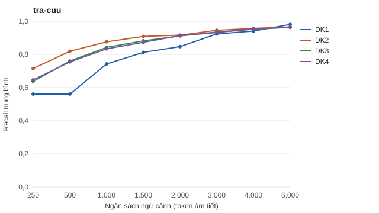
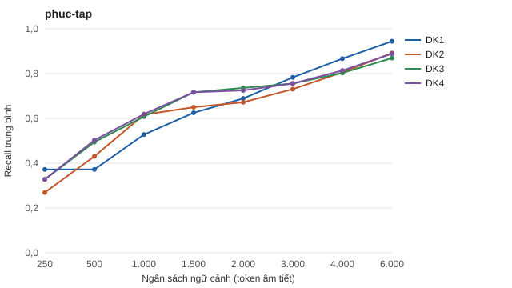
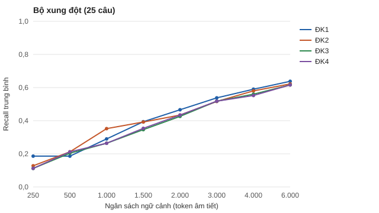
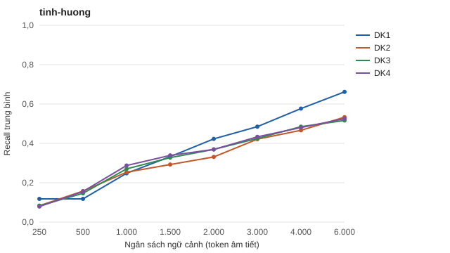
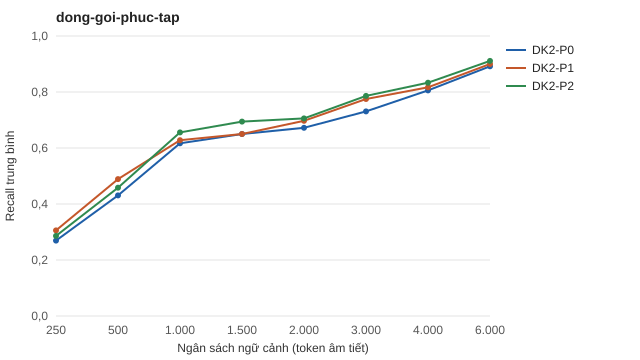

# Bảng số liệu WP2, WP3 (chạy thử, 11/11/2026)

## tra-cuu

Câu hỏi có nhãn: 131.

Recall trung bình theo ngân sách token:

| Điều kiện | 250 | 500 | 1.000 | 1.500 | 2.000 | 3.000 | 4.000 | 6.000 |
|---|---|---|---|---|---|---|---|---|
| DK1 | 0,56 | 0,56 | 0,74 | 0,81 | 0,85 | 0,92 | 0,94 | 0,98 |
| DK2 | 0,72 | 0,82 | 0,88 | 0,91 | 0,92 | 0,95 | 0,96 | 0,97 |
| DK3 | 0,64 | 0,76 | 0,84 | 0,88 | 0,91 | 0,94 | 0,95 | 0,96 |
| DK4 | 0,65 | 0,75 | 0,83 | 0,87 | 0,91 | 0,93 | 0,95 | 0,96 |

Tỉ lệ câu tìm đủ mọi đơn vị đáp án theo ngân sách:

| Điều kiện | 250 | 500 | 1.000 | 1.500 | 2.000 | 3.000 | 4.000 | 6.000 |
|---|---|---|---|---|---|---|---|---|
| DK1 | 0,54 | 0,54 | 0,71 | 0,79 | 0,83 | 0,91 | 0,93 | 0,98 |
| DK2 | 0,66 | 0,77 | 0,82 | 0,87 | 0,88 | 0,92 | 0,93 | 0,95 |
| DK3 | 0,59 | 0,71 | 0,80 | 0,85 | 0,87 | 0,90 | 0,92 | 0,94 |
| DK4 | 0,60 | 0,70 | 0,79 | 0,83 | 0,88 | 0,90 | 0,92 | 0,94 |

Ngân sách nhỏ nhất để recall trung bình đạt ngưỡng (token; `-` là không đạt trong độ sâu đã xếp hạng):

| Điều kiện | recall 0,4 | recall 0,8 | Token trung bình mỗi bản ghi |
|---|---|---|---|
| DK1 | 263 | 1.228 | 381,3 |
| DK2 | 38 | 447 | 45,4 |
| DK3 | 47 | 612 | 55,9 |
| DK4 | 47 | 632 | 55,3 |

Lượt chạy:

- DK1: `experiments/runs/budget-2026-11-11/dryrun-v1-dk1` (đóng gói P0)
- DK2: `experiments/runs/budget-2026-11-11/dryrun-v1-dk2` (đóng gói P0)
- DK3: `experiments/runs/budget-2026-11-11/dryrun-v1-dk3` (đóng gói P0)
- DK4: `experiments/runs/budget-2026-11-11/dryrun-v1-dk4` (đóng gói P0)

## phuc-tap

Câu hỏi có nhãn: 30.

Recall trung bình theo ngân sách token:

| Điều kiện | 250 | 500 | 1.000 | 1.500 | 2.000 | 3.000 | 4.000 | 6.000 |
|---|---|---|---|---|---|---|---|---|
| DK1 | 0,37 | 0,37 | 0,53 | 0,62 | 0,69 | 0,78 | 0,87 | 0,94 |
| DK2 | 0,27 | 0,43 | 0,62 | 0,65 | 0,67 | 0,73 | 0,81 | 0,89 |
| DK3 | 0,33 | 0,49 | 0,61 | 0,72 | 0,74 | 0,76 | 0,80 | 0,87 |
| DK4 | 0,33 | 0,50 | 0,62 | 0,72 | 0,72 | 0,76 | 0,81 | 0,89 |

Tỉ lệ câu tìm đủ mọi đơn vị đáp án theo ngân sách:

| Điều kiện | 250 | 500 | 1.000 | 1.500 | 2.000 | 3.000 | 4.000 | 6.000 |
|---|---|---|---|---|---|---|---|---|
| DK1 | 0,03 | 0,03 | 0,20 | 0,27 | 0,33 | 0,50 | 0,67 | 0,83 |
| DK2 | 0,03 | 0,13 | 0,27 | 0,37 | 0,37 | 0,40 | 0,53 | 0,70 |
| DK3 | 0,10 | 0,20 | 0,30 | 0,43 | 0,47 | 0,47 | 0,57 | 0,67 |
| DK4 | 0,10 | 0,20 | 0,30 | 0,43 | 0,43 | 0,47 | 0,57 | 0,70 |

Ngân sách nhỏ nhất để recall trung bình đạt ngưỡng (token; `-` là không đạt trong độ sâu đã xếp hạng):

| Điều kiện | recall 0,4 | recall 0,8 | Token trung bình mỗi bản ghi |
|---|---|---|---|
| DK1 | 784 | 3.219 | 381,3 |
| DK2 | 394 | 3.964 | 45,4 |
| DK3 | 323 | 3.954 | 55,9 |
| DK4 | 323 | 3.817 | 55,3 |

Lượt chạy:

- DK1: `experiments/runs/budget-2026-11-11/dryrun-complex-v1-dk1` (đóng gói P0)
- DK2: `experiments/runs/budget-2026-11-11/dryrun-complex-v1-dk2` (đóng gói P0)
- DK3: `experiments/runs/budget-2026-11-11/dryrun-complex-v1-dk3` (đóng gói P0)
- DK4: `experiments/runs/budget-2026-11-11/dryrun-complex-v1-dk4` (đóng gói P0)

## xung-dot

Câu hỏi có nhãn: 25.

Recall trung bình theo ngân sách token:

| Điều kiện | 250 | 500 | 1.000 | 1.500 | 2.000 | 3.000 | 4.000 | 6.000 |
|---|---|---|---|---|---|---|---|---|
| DK1 | 0,19 | 0,19 | 0,29 | 0,39 | 0,47 | 0,54 | 0,59 | 0,64 |
| DK2 | 0,13 | 0,21 | 0,35 | 0,39 | 0,43 | 0,52 | 0,58 | 0,62 |
| DK3 | 0,11 | 0,20 | 0,26 | 0,35 | 0,43 | 0,52 | 0,56 | 0,62 |
| DK4 | 0,11 | 0,21 | 0,26 | 0,35 | 0,43 | 0,52 | 0,55 | 0,62 |

Tỉ lệ câu tìm đủ mọi đơn vị đáp án theo ngân sách:

| Điều kiện | 250 | 500 | 1.000 | 1.500 | 2.000 | 3.000 | 4.000 | 6.000 |
|---|---|---|---|---|---|---|---|---|
| DK1 | 0,00 | 0,00 | 0,00 | 0,04 | 0,08 | 0,08 | 0,12 | 0,12 |
| DK2 | 0,00 | 0,00 | 0,00 | 0,04 | 0,04 | 0,04 | 0,12 | 0,16 |
| DK3 | 0,00 | 0,00 | 0,00 | 0,00 | 0,00 | 0,04 | 0,08 | 0,16 |
| DK4 | 0,00 | 0,00 | 0,00 | 0,00 | 0,00 | 0,04 | 0,08 | 0,16 |

Ngân sách nhỏ nhất để recall trung bình đạt ngưỡng (token; `-` là không đạt trong độ sâu đã xếp hạng):

| Điều kiện | recall 0,4 | recall 0,8 | Token trung bình mỗi bản ghi |
|---|---|---|---|
| DK1 | 1.601 | 15.054 | 381,3 |
| DK2 | 1.518 | 16.312 | 45,4 |
| DK3 | 1.837 | 18.938 | 55,9 |
| DK4 | 1.839 | 18.378 | 55,3 |

Lượt chạy:

- DK1: `experiments/runs/budget-2026-11-11/dryrun-conflict-v1-dk1` (đóng gói P0)
- DK2: `experiments/runs/budget-2026-11-11/dryrun-conflict-v1-dk2` (đóng gói P0)
- DK3: `experiments/runs/budget-2026-11-11/dryrun-conflict-v1-dk3` (đóng gói P0)
- DK4: `experiments/runs/budget-2026-11-11/dryrun-conflict-v1-dk4` (đóng gói P0)

## tinh-huong

Câu hỏi có nhãn: 44.

Recall trung bình theo ngân sách token:

| Điều kiện | 250 | 500 | 1.000 | 1.500 | 2.000 | 3.000 | 4.000 | 6.000 |
|---|---|---|---|---|---|---|---|---|
| DK1 | 0,12 | 0,12 | 0,25 | 0,33 | 0,42 | 0,48 | 0,58 | 0,66 |
| DK2 | 0,08 | 0,16 | 0,25 | 0,29 | 0,33 | 0,42 | 0,47 | 0,53 |
| DK3 | 0,08 | 0,15 | 0,27 | 0,33 | 0,37 | 0,42 | 0,48 | 0,52 |
| DK4 | 0,08 | 0,16 | 0,29 | 0,34 | 0,37 | 0,43 | 0,48 | 0,53 |

Tỉ lệ câu tìm đủ mọi đơn vị đáp án theo ngân sách:

| Điều kiện | 250 | 500 | 1.000 | 1.500 | 2.000 | 3.000 | 4.000 | 6.000 |
|---|---|---|---|---|---|---|---|---|
| DK1 | 0,00 | 0,00 | 0,00 | 0,00 | 0,00 | 0,02 | 0,07 | 0,16 |
| DK2 | 0,00 | 0,00 | 0,00 | 0,00 | 0,00 | 0,00 | 0,02 | 0,05 |
| DK3 | 0,00 | 0,00 | 0,00 | 0,02 | 0,02 | 0,02 | 0,02 | 0,02 |
| DK4 | 0,00 | 0,00 | 0,00 | 0,02 | 0,02 | 0,02 | 0,02 | 0,05 |

Ngân sách nhỏ nhất để recall trung bình đạt ngưỡng (token; `-` là không đạt trong độ sâu đã xếp hạng):

| Điều kiện | recall 0,4 | recall 0,8 | Token trung bình mỗi bản ghi |
|---|---|---|---|
| DK1 | 1.628 | 17.208 | 381,3 |
| DK2 | 2.598 | - | 45,4 |
| DK3 | 2.304 | - | 55,9 |
| DK4 | 2.304 | - | 55,3 |

Lượt chạy:

- DK1: `experiments/runs/budget-2026-11-11/dryrun-cases-v1-dk1` (đóng gói P0)
- DK2: `experiments/runs/budget-2026-11-11/dryrun-cases-v1-dk2` (đóng gói P0)
- DK3: `experiments/runs/budget-2026-11-11/dryrun-cases-v1-dk3` (đóng gói P0)
- DK4: `experiments/runs/budget-2026-11-11/dryrun-cases-v1-dk4` (đóng gói P0)

## dong-goi-phuc-tap

Câu hỏi có nhãn: 30.

Recall trung bình theo ngân sách token:

| Điều kiện | 250 | 500 | 1.000 | 1.500 | 2.000 | 3.000 | 4.000 | 6.000 |
|---|---|---|---|---|---|---|---|---|
| DK2-P0 | 0,27 | 0,43 | 0,62 | 0,65 | 0,67 | 0,73 | 0,81 | 0,89 |
| DK2-P1 | 0,31 | 0,49 | 0,63 | 0,65 | 0,70 | 0,78 | 0,82 | 0,90 |
| DK2-P2 | 0,29 | 0,46 | 0,66 | 0,69 | 0,71 | 0,79 | 0,83 | 0,91 |

Tỉ lệ câu tìm đủ mọi đơn vị đáp án theo ngân sách:

| Điều kiện | 250 | 500 | 1.000 | 1.500 | 2.000 | 3.000 | 4.000 | 6.000 |
|---|---|---|---|---|---|---|---|---|
| DK2-P0 | 0,03 | 0,13 | 0,27 | 0,37 | 0,37 | 0,40 | 0,53 | 0,70 |
| DK2-P1 | 0,07 | 0,13 | 0,30 | 0,37 | 0,37 | 0,47 | 0,57 | 0,73 |
| DK2-P2 | 0,00 | 0,13 | 0,33 | 0,43 | 0,43 | 0,50 | 0,57 | 0,73 |

Ngân sách nhỏ nhất để recall trung bình đạt ngưỡng (token; `-` là không đạt trong độ sâu đã xếp hạng):

| Điều kiện | recall 0,4 | recall 0,8 | Token trung bình mỗi bản ghi |
|---|---|---|---|
| DK2-P0 | 394 | 3.964 | 45,4 |
| DK2-P1 | 372 | 3.689 | 45,4 |
| DK2-P2 | 348 | 3.061 | 45,4 |

Lượt chạy:

- DK2-P0: `experiments/runs/budget-2026-11-11/dryrun-complex-v1-dk2` (đóng gói P0)
- DK2-P1: `experiments/runs/budget-2026-11-11/dryrun-complex-v1-dk2-P1` (đóng gói P1)
- DK2-P2: `experiments/runs/budget-2026-11-11/dryrun-complex-v1-dk2-P2` (đóng gói P2)

## dong-goi-xung-dot

Câu hỏi có nhãn: 25.

Recall trung bình theo ngân sách token:

| Điều kiện | 250 | 500 | 1.000 | 1.500 | 2.000 | 3.000 | 4.000 | 6.000 |
|---|---|---|---|---|---|---|---|---|
| DK2-P0 | 0,13 | 0,21 | 0,35 | 0,39 | 0,43 | 0,52 | 0,58 | 0,62 |
| DK2-P1 | 0,14 | 0,24 | 0,37 | 0,42 | 0,46 | 0,54 | 0,60 | 0,66 |
| DK2-P2 | 0,11 | 0,24 | 0,37 | 0,44 | 0,48 | 0,54 | 0,61 | 0,66 |

Tỉ lệ câu tìm đủ mọi đơn vị đáp án theo ngân sách:

| Điều kiện | 250 | 500 | 1.000 | 1.500 | 2.000 | 3.000 | 4.000 | 6.000 |
|---|---|---|---|---|---|---|---|---|
| DK2-P0 | 0,00 | 0,00 | 0,00 | 0,04 | 0,04 | 0,04 | 0,12 | 0,16 |
| DK2-P1 | 0,00 | 0,00 | 0,00 | 0,04 | 0,04 | 0,04 | 0,16 | 0,28 |
| DK2-P2 | 0,00 | 0,00 | 0,04 | 0,04 | 0,04 | 0,08 | 0,16 | 0,28 |

Ngân sách nhỏ nhất để recall trung bình đạt ngưỡng (token; `-` là không đạt trong độ sâu đã xếp hạng):

| Điều kiện | recall 0,4 | recall 0,8 | Token trung bình mỗi bản ghi |
|---|---|---|---|
| DK2-P0 | 1.518 | 16.312 | 45,4 |
| DK2-P1 | 1.246 | 11.897 | 45,4 |
| DK2-P2 | 1.161 | 10.806 | 45,4 |

Lượt chạy:

- DK2-P0: `experiments/runs/budget-2026-11-11/dryrun-conflict-v1-dk2` (đóng gói P0)
- DK2-P1: `experiments/runs/budget-2026-11-11/dryrun-conflict-v1-dk2-P1` (đóng gói P1)
- DK2-P2: `experiments/runs/budget-2026-11-11/dryrun-conflict-v1-dk2-P2` (đóng gói P2)

## dong-goi-tinh-huong

Câu hỏi có nhãn: 44.

Recall trung bình theo ngân sách token:

| Điều kiện | 250 | 500 | 1.000 | 1.500 | 2.000 | 3.000 | 4.000 | 6.000 |
|---|---|---|---|---|---|---|---|---|
| DK2-P0 | 0,08 | 0,16 | 0,25 | 0,29 | 0,33 | 0,42 | 0,47 | 0,53 |
| DK2-P1 | 0,08 | 0,16 | 0,25 | 0,31 | 0,38 | 0,46 | 0,49 | 0,57 |
| DK2-P2 | 0,07 | 0,14 | 0,26 | 0,35 | 0,41 | 0,48 | 0,53 | 0,59 |

Tỉ lệ câu tìm đủ mọi đơn vị đáp án theo ngân sách:

| Điều kiện | 250 | 500 | 1.000 | 1.500 | 2.000 | 3.000 | 4.000 | 6.000 |
|---|---|---|---|---|---|---|---|---|
| DK2-P0 | 0,00 | 0,00 | 0,00 | 0,00 | 0,00 | 0,00 | 0,02 | 0,05 |
| DK2-P1 | 0,00 | 0,00 | 0,00 | 0,00 | 0,00 | 0,02 | 0,05 | 0,07 |
| DK2-P2 | 0,00 | 0,00 | 0,00 | 0,00 | 0,00 | 0,00 | 0,02 | 0,07 |

Ngân sách nhỏ nhất để recall trung bình đạt ngưỡng (token; `-` là không đạt trong độ sâu đã xếp hạng):

| Điều kiện | recall 0,4 | recall 0,8 | Token trung bình mỗi bản ghi |
|---|---|---|---|
| DK2-P0 | 2.598 | - | 45,4 |
| DK2-P1 | 2.268 | - | 45,4 |
| DK2-P2 | 1.959 | - | 45,4 |

Lượt chạy:

- DK2-P0: `experiments/runs/budget-2026-11-11/dryrun-cases-v1-dk2` (đóng gói P0)
- DK2-P1: `experiments/runs/budget-2026-11-11/dryrun-cases-v1-dk2-P1` (đóng gói P1)
- DK2-P2: `experiments/runs/budget-2026-11-11/dryrun-cases-v1-dk2-P2` (đóng gói P2)
